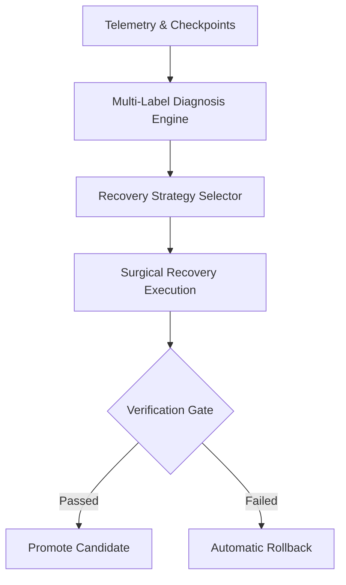

# AMRS Architecture

## High-Level System Architecture

AMRS (Adaptive Model Recovery System) automates model failure diagnosis, applies targeted low-cost recovery strategies to an isolated copy of the model, verifies candidate weights through a verification gate against a holdout dataset, and either commits or rolls back changes.

## Key Modules

1. **Diagnosis Engine (`amrs.diagnosis`)**: Rules and statistical probes analyzing validation curves, generalization gaps, ECE, and Hessian spectral norms.
2. **Strategy Selector (`amrs.selector`)**: Ranked heuristic selector ordering actions by expected recovery probability and compute cost.
3. **Recovery Strategies (`amrs.recovery`)**:
   - Temperature Scaling
   - BatchNorm Recalibration
   - Checkpoint Reversion & Averaging
   - Selective Fine-Tuning
   - L2-SP Regularized Adaptation
   - Weight Interpolation
4. **Verification Gate (`amrs.evaluation.gate`)**: Strict validation gate computing empirical retention, accuracy gains, and calibration improvements via paired bootstrapping.
5. **Storage & Registry (`amrs.store`, `amrs.models`)**: SQLite repository and model zoo tracking runs, candidates, and artifacts.

