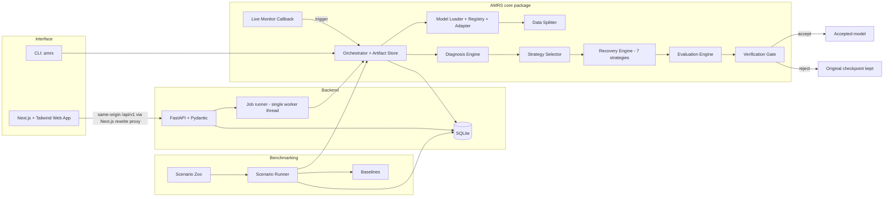
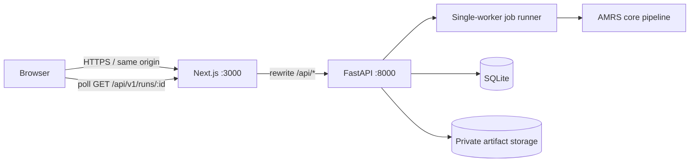

# AMRS — Adaptive Model Recovery System
## PRD + MVP + Implementation Blueprint

**Revised version:** 1.2 — team ownership, backend/frontend responsibility split and delivery gates added

---

## 0. Document Control

| Field | Value |
|---|---|
| Document version | 1.2 |
| Date | 2026-11-05 |
| Project name | **AMRS** (Adaptive Model Recovery System). "AMR" in `Novex.txt` is an alias. |
| Team | Big Dawgs, NOVEX Hackathon 2026 |
| Source files used | `Novex.txt` (problem, solution, components, stack), `Big_Dawgs_-_Novex.pdf` (6 slides: title, idea, technical approach, feasibility, impact, references), and the master prompt |
| Status | Approved baseline; frontend/integration revision added. The uploaded source ends after DM-4.1, so later ML, BM, BE, QA and DOC department parts remain to be supplied or authored before the entire blueprint can be considered execution-complete. |

### 0.1 Fields supplied vs inferred

| Field | Value | Source |
|---|---|---|
| Project name | AMRS | PDF slide 1 |
| One-line goal | Diagnose why a trained model underperforms, repair it cheaply, and accept the repair only if it is verified better. Otherwise keep the original. | `Novex.txt` |
| Target users | ML students, ML engineers at small and large teams, MLOps leads | `Novex.txt` ("students to large companies") |
| Deadline | **Inferred: 14 calendar days of build time** | **[ASSUMPTION]** No deadline is given. Section 6 proposes a 14-day schedule; confirm or revise it with the team. |
| Preferred stack | Python 3.11, PyTorch, Torchvision, HF PEFT, scikit-learn, NumPy, Pandas, FastAPI, Pydantic v2, YAML, SQLite, **Next.js App Router + React + TypeScript + Tailwind CSS**, Plotly.js, Matplotlib, pytest, Git/GitHub, Colab/Kaggle | Backend/ML choices from source files; frontend replacement approved by user for this revision |
| Team size and skill | **3 contributors: Manas (frontend), Aayush (backend), Manthan (frontend + backend technical lead)** | Supplied by team for v1.2. Individual skill levels are not assumed. |

### 0.2 Conflicts between files, and how each is resolved

| ID | Conflict | Resolution |
|---|---|---|
| C1 | `Novex.txt` says "AMR" and the PDF says "AMRS". | Use **AMRS** everywhere. "AMR" is kept as an alias in docs. |
| C2 | `Novex.txt` says AMR "guarantees genuine improvement" and the model "never ends up worse". The PDF says "potentially lower recovery compute" and "verify before accepting". An absolute guarantee is impossible with finite holdout data. | Reworded as the **verification guarantee**: no candidate is accepted unless it beats the original on a held-out set under a paired-bootstrap confidence test with no-regression constraints. The claim is statistical and applies to the holdout distribution. Marketing copy uses this wording. |
| C3 | `Novex.txt` lists *checkpoint averaging* and *weight interpolation*. The PDF table lists *checkpoint reversion* or *weight interpolation*. `Novex.txt` also lists LoRA for transformers, while the PDF scopes the MVP to "supported PyTorch classifiers". | MVP builds checkpoint reversion, checkpoint averaging and weight interpolation. **LoRA/PEFT is Post-MVP** (ML-10). |
| C4 | `Novex.txt` has a "rule-based selector that tries methods cheapest first". The PDF has a diagnosis→strategy table. | Combined. The diagnosis selects the **eligible set** (PDF table). The selector orders eligible strategies **by ascending compute cost** and tries them until one passes the gate or the budget is exhausted. |
| C5 | The PDF dashboard lets users "Upload model". Loading arbitrary pickled PyTorch files is a remote-code-execution risk. | Uploads accept only `state_dict` files, loaded with `torch.load(weights_only=True)`, and only for architectures in the **model registry**. Custom architectures are supported only in local CLI mode via an explicit `--model-module` flag. See QA-2. |
| C6 | The PDF says "Prepare train/val/test". `Novex.txt` says "separate held-out dataset" for verification. | Four-way data contract: `train`, `val` (diagnosis and candidate selection), `holdout` (gate only), and optional unlabeled `target` (BatchNorm recalibration). Defined in DM-2. |
| C7 | PDF Key Problem #2 is "Performance drift". No drift detector appears in the solution. | MVP covers **covariate-shift recovery** (BN drift diagnosis and recalibration, temperature scaling). Continuous production drift monitoring is a non-goal (Section 1.6). |
| C8 | PDF references 7–10 (CheckFreq, Hyperband, machine unlearning, checkpointed HPO) map to no listed method. | Treated as background only. Nothing is built from them. References 1–6 are said to support built or planned features in the source material, but the bibliography/reference section was not present in the uploaded file and must be restored and verified. |
| C9 | `Novex.txt` names the "Domain" as AI-Intelligent Systems and the PDF names the "PS Category" as AI and ML. | Cosmetic. Use the PDF wording in submissions. |

### 0.3 Approved technology decision

**The frontend is Next.js + React + TypeScript + Tailwind CSS. Streamlit is not part of the application.** Streamlit references in the original proposal are retained only as source-history context and are superseded by this decision. The browser UI is a separate Next.js application; FastAPI remains the backend and the only service allowed to execute model recovery. The browser communicates with FastAPI through a same-origin `/api` proxy configured by Next.js.

### 0.4 Source-plan completeness note

The source `plan.md` available for this revision ended during DM-4.1. The v1.1 revision added FE and the frontend/backend connection contract. The source still does not provide detailed implementation parts for ML, BM, BE, QA or DOC, and its referenced Sections 6–12 were absent. Version 1.2 adds team ownership, a scoped backend work breakdown and a practical execution schedule. These additions are an implementation proposal, not a reconstruction of missing approved source content. The ML recovery algorithms, benchmark methodology, QA/security test catalogue and documentation/demo tasks still require a detailed technical specification before the plan can be called fully execution-ready.


### 0.5 Team ownership principles

The project has three contributors. Each work item must have one directly responsible individual (DRI); reviewers do not silently become co-owners. **Manthan is the technical lead and owns the high-risk cross-stack boundary**, including the security-sensitive parts of both frontend and backend. Manas owns the visible frontend product work. Aayush owns the backend recovery/domain implementation that is not explicitly reserved as a security or release-critical Manthan responsibility.

- **Manas — Frontend implementation:** page layouts, design system, reusable UI components, forms, charts, responsive behavior, accessibility and frontend component tests. He must use the API client and schemas agreed with Manthan; he must not create mock business logic or bypass the API boundary.
- **Aayush — Backend and recovery implementation:** diagnosis and recovery algorithms, strategy implementations, benchmark execution, database persistence, ordinary API resource handlers, CLI and backend unit/integration tests. He owns correctness of backend domain behavior and reports contract changes before implementing them.
- **Manthan — Technical lead, security owner and cross-stack integrator:** API contract, Next.js proxy/API client, upload and artifact security, job execution/cancellation boundary, verification gate and holdout integrity, configuration/policy validation, deployment topology, integration/E2E and release sign-off. Manthan also implements the security-sensitive backend/frontend code rather than delegating it.

**Decision rule:** when a task touches untrusted model files, filesystem paths, subprocess/job execution, public network exposure, secrets, holdout data, acceptance decisions or browser-to-API trust boundaries, Manthan is the DRI. Aayush and Manas may contribute tests or adjacent code, but Manthan approves and owns the final implementation. Avoid shared ownership labels such as “Manas/Manthan”; split the task into independently reviewable items instead.

### 0.6 How to use this document

1. Read Sections 1–4 once so the North Star, scope and architecture are shared.
2. Build in the order of **Section 6**. Every Part in Section 5 lists its prerequisites.
3. For each Part, paste its **AGENT PROMPT** into a fresh AI coding-agent session. Each prompt is self-contained.
4. A Part is done only when every acceptance criterion passes, its tests pass in CI, and the agent's report is reviewed by a human.
5. Items tagged **[ASSUMPTION]** are decisions made on the team's behalf. Confirm them before implementation. The uploaded source did not contain its referenced Sections 6–12; this v1.2 adds a team execution schedule as Section 6, but does not invent the missing research/reference material.

---

## 1. Project Overview

### 1.1 North Star

> **AMRS turns model recovery from manual trial and error into an automated pipeline that diagnoses why a trained classifier underperforms, repairs the existing weights cheapest-first, and keeps a repair only if it is verified better on held-out data. Otherwise it keeps the original model untouched.**

Every Part in this document traces to this sentence through three verbs: **diagnose**, **repair cheaply**, **verify or roll back**.

### 1.2 Problem
Trained models overfit, generalize poorly, or degrade. Fixes are manual (tweak, rerun, retrain), waste compute, can erase learned knowledge, and offer no evidence that the result is better. Existing tools detect problems or apply one fixed remedy. No widely available tool diagnoses, chooses among remedies, and gates acceptance on verification (`Novex.txt`, "Problem Statement").

### 1.3 Vision
A model-recovery layer that any PyTorch classification workflow can run after training, or during training through a callback. It preserves the original model and accepts a candidate only when the configured held-out verification policy passes; otherwise it rolls back, with an auditable evidence trail.

### 1.4 Personas

| ID | Persona | Context | Primary need | AMRS feature that serves it |
|---|---|---|---|---|
| P1 | **Aarav**, student, 2nd-year CS | Trains CIFAR models on Colab. Overfits, doesn't know why. | A plain-language diagnosis and one-click fix | Diagnosis report with evidence, Run page |
| P2 | **Meera**, ML engineer, 10-person startup | Fine-tuned model degrades on new camera data. Limited GPU budget. | Cheap recovery without a full retrain | BN recalibration, last-layer fine-tune, compute report |
| P3 | **Rohan**, MLOps lead | Must prove a model change is safe before shipping. | Auditable accept/reject decisions | Verification gate, rollback, run history |
| P4 | **Judge / reviewer** | Sees a 5–10 minute demo. | A clear before/after story with honest numbers | Scenario zoo, benchmark page, rollback demo |

### 1.5 Value proposition
- **Replaces manual trial and error** with a rule-based diagnosis and strategy selector.
- **Cheaper than retraining**: strategies are ordered by compute cost.
- **Preserves knowledge**: edits are targeted, L2-SP-anchored, and checked with a retained-knowledge metric.
- **Safe**: the original is never mutated, and every candidate must pass the gate.
- **Transparent**: the dashboard shows before/after metrics, compute and each intervention's effect.

### 1.6 Success metrics (measurable)
Measured on the six-scenario zoo (DM-4) with 3 seeds each (18 runs), using the default acceptance policy.

| ID | Metric | Target |
|---|---|---|
| M1 | **Recovery effectiveness**: failure scenarios (S1–S5) where AMRS accepts a candidate whose primary metric beats the original on holdout (seed-mean) | ≥ 4 of 5 scenarios |
| M2 | **Safety**: harmful acceptances. A harmful acceptance is an accepted candidate whose primary metric is worse than the original by more than the tolerance on a **fresh** evaluation split. | **0 of 18 runs** |
| M3 | **Healthy-control behavior**: S6 runs ending in "no change accepted" or "healthy, no action" | 3 of 3 seeds |
| M4 | **Cost efficiency**: scenarios where AMRS gain-per-compute-unit exceeds full retraining's | ≥ 4 of 5 |
| M5 | **Diagnosis accuracy**: top-1 diagnosis label matches the scenario's ground-truth label | ≥ 15 of 18 runs (≥ 83%) |
| M6 | **Knowledge retention**: mean retained-correct rate of accepted candidates | ≥ 0.95 |
| M7 | **Monitor false triggers**: false recovery triggers on healthy training runs | ≤ 1 across 3 seeds |
| M8 | **Responsiveness**: end-to-end S1 run on a Colab T4, or on CPU with the small-CNN variant | ≤ 10 min on T4, ≤ 15 min on CPU variant |
| M9 | **Engineering quality**: core-package line coverage and CI status | ≥ 80%, CI green on main |
| M10 | **Reproducibility**: same config + seed gives identical accept/reject decisions and primary-metric deltas within ±0.002 | 3 repeated runs |

### 1.7 Non-goals (explicitly out of scope)
- Regression, detection, segmentation, generative and reinforcement-learning models.
- Production drift monitoring, data pipelines and alerting.
- Distributed or multi-GPU training.
- Automated hyperparameter optimization (PDF refs 8 and 10 are background only).
- Machine unlearning (PDF ref 9) and data-influence analysis (PDF ref 5).
- Multi-tenant SaaS, user accounts and billing.
- Guarantees on data outside the holdout distribution.
- Fixing label noise, data leakage or bad data. AMRS reports suspicion only.

---

## 2. Complete Project Detail

### 2.1 Feature list

| ID | Feature | Description |
|---|---|---|
| F1 | Model intake | Accept a PyTorch classifier as a `state_dict` plus an architecture name from the **model registry** (`mlp_small`, `small_cnn`, `resnet18_cifar`). Optional list of earlier checkpoints (history) and an optional training-history JSON. Local CLI mode also accepts `--model-module path.py:factory`. |
| F2 | Data intake and splitting | Accept `train`, `val`, `holdout`, optional `target` (unlabeled). Deterministic stratified splitting when only some are given (rules in DM-2). |
| F3 | Diagnosis engine | Computes train/val accuracy and loss, generalization gap, validation-loss trend (when history exists), ECE, BN statistics divergence, a linear-probe head test and a loss-instability score. Outputs a ranked multi-label `DiagnosisReport` with evidence. |
| F4 | Strategy selector | Maps diagnosis labels to eligible strategies (PDF slide 3 table), filters by prerequisites (checkpoints, unlabeled data, architecture support), orders by cost ascending, enforces a candidate budget. |
| F5 | Recovery strategies | `temperature_scaling`, `bn_recalibration`, `checkpoint_reversion`, `checkpoint_averaging`, `last_layer_finetune`, `selective_finetune_l2sp`, `weight_interpolation`. All operate on a **copy** of the model. |
| F6 | Evaluation engine | Compares original vs candidate on holdout: accuracy, NLL, ECE, retained-knowledge, top-1 agreement, compute cost. Paired bootstrap CIs. |
| F7 | Verification gate | Applies the acceptance policy (YAML). Returns `ACCEPT` or `REJECT` with machine-readable reasons per criterion. |
| F8 | Rollback and artifacts | The original checkpoint is hashed, copied read-only, and never mutated. If no candidate passes, the output model is byte-identical to the input. |
| F9 | Live training monitor | A PyTorch callback tracking smoothed train/val metrics. Detects overfitting and instability with patience and cooldown. Actions: `log`, `early_stop`, `recover` (revert to best snapshot, then run the pipeline). |
| F10 | Benchmark runner | Runs AMRS against early stopping, regularized fine-tuning, full retraining and fixed-strategy baselines across scenarios and seeds. Records accuracy, ECE, retention, compute and wall time. |
| F11 | Run store | SQLite database of runs, diagnoses, candidates, gate decisions, monitor events and benchmark results. |
| F12 | REST API | FastAPI with Pydantic schemas. Job-based runs, polling for progress. |
| F13 | CLI | `amrs diagnose`, `amrs recover`, `amrs monitor-replay`, `amrs benchmark`, `amrs scenarios build`. |
| F14 | Dashboard | Next.js pages: Run Recovery, Results, Benchmarks, Live Monitor, History. Plotly charts. |
| F15 | Scenario zoo | Reproducible generator for six scenarios, S1–S6, with ground-truth labels. |
| F16 | YAML configuration | All thresholds, budgets, seeds and policies live in YAML validated by Pydantic. A run stores its resolved config. |
| F17 | Report export (Should) | Per-run `report.json` and `report.md` with the decision trail. |
| F18 | LoRA/PEFT recovery (Post-MVP) | Adapter-based recovery for HF transformers. |

### 2.2 Scenario zoo (ground truth for tests, demo and metrics)

| ID | Name | How it is created (reproducibly) | Ground-truth label | Expected AMRS behavior |
|---|---|---|---|---|
| S1 | Overfit | `resnet18_cifar` (or `small_cnn` on CPU) trained on a 5,000-image CIFAR-10 subset, no augmentation, 60 epochs, per-epoch checkpoints | `overfitting` | Checkpoint reversion/averaging and/or selective fine-tune + L2-SP accepted |
| S2 | Miscalibrated | Healthy model with its final-layer weights and bias scaled ×2.5 (accuracy unchanged, confidence inflated) | `miscalibration` | Temperature scaling accepted (primary metric ECE) |
| S3 | BN drift | Healthy model evaluated on a shifted target distribution (brightness/contrast shift + Gaussian noise, severity configurable). `val`, `holdout` and unlabeled `target` come from the shifted distribution. | `bn_drift` | BN recalibration accepted |
| S4 | Unstable training | Same architecture trained with an excessive learning rate (SGD lr 0.5, no warmup), checkpoints saved, final weights landing on a loss spike | `instability` | Checkpoint reversion or averaging accepted |
| S5 | Degraded head | Healthy backbone, head fine-tuned for a few epochs on 40%-label-noise data | `head_degradation` | Last-layer fine-tune accepted |
| S6 | Healthy control | Well-regularized model, augmentation and weight decay | `healthy` | Diagnosis = healthy, or every candidate rejected. Output is byte-identical to input. |

**[ASSUMPTION]** Synthetic constructions for S2, S3 and S5 are used because they isolate one failure mode and run in minutes. The CIFAR-10-C dataset is not used, to avoid a large download. The limitation is documented (R-09).

### 2.3 User flows

**Flow A. One-shot recovery (dashboard, primary demo flow)**
1. User opens **Run Recovery** and selects a scenario from the zoo or uploads a `state_dict` and chooses an architecture and dataset.
2. UI shows the resolved config (splits, acceptance policy) and a **Start** button.
3. API creates a run (`202`, `run_id`). UI polls progress: *Loading → Diagnosing → Trying strategy k/N → Verifying → Done*.
4. **Results** page shows the diagnosis (labels, confidence, evidence), a candidates table (strategy, cost, primary-metric delta, retention, gate verdict and reasons), a before/after chart, the final verdict (`ACCEPTED: <strategy>` or `ROLLED BACK: original kept`), and downloads (`accepted_model.pt`, `report.json`).

**Flow B. Live monitoring**
1. User attaches `AMRSCallback` in their training loop (documented snippet), or opens **Live Monitor** and replays a recorded training run (S1 or S4).
2. Monitor tracks smoothed metrics. On trigger it logs an event, optionally stops training or runs recovery on the best snapshot.
3. Next.js dashboard shows the metric curves with trigger markers and the follow-up recovery result.

**Flow C. Benchmark**
1. User selects scenarios, seeds and baselines, then clicks **Run benchmark** (or loads stored results).
2. Page shows a comparison table and charts of accuracy, ECE, compute units and wall time per method, with mean ± std over seeds.

**Flow D. Review history**
User opens **History**, filters by scenario or verdict, opens any past run's Results and downloads its report.

**Flow E. CLI**
`amrs recover --model-module ... --weights w.pt --data ... --config configs/default.yaml` produces the same artifacts as Flow A.

### 2.4 Data model (SQLite)

| Table | Columns |
|---|---|
| `runs` | `id` (UUID PK), `created_at`, `status` (`queued`/`running`/`succeeded`/`failed`/`cancelled`), `scenario_id`, `arch`, `original_sha256`, `config_json`, `seed`, `verdict` (`accepted`/`rolled_back`/`healthy_no_action`/`error`), `accepted_strategy`, `error_message`, `duration_s`, `compute_units_total` |
| `diagnoses` | `run_id` FK, `label`, `confidence`, `evidence_json`, `rank` |
| `candidates` | `id`, `run_id` FK, `order_idx`, `strategy`, `params_json`, `cost_units`, `wall_s`, `val_metrics_json`, `holdout_metrics_json`, `primary_metric`, `delta_primary`, `ci_low`, `ci_high`, `retention`, `agreement`, `gate_decision`, `gate_reasons_json`, `artifact_path` |
| `monitor_events` | `id`, `run_id`, `epoch`, `kind` (`overfit_warning`/`instability_warning`/`trigger`/`action`/`cooldown`), `details_json` |
| `benchmark_runs` | `id`, `created_at`, `config_json`, `status` |
| `benchmark_results` | `id`, `benchmark_id` FK, `scenario_id`, `seed`, `method`, `accuracy`, `ece`, `nll`, `retention`, `compute_units`, `wall_s`, `accepted` (nullable), `notes` |
| `schema_version` | `version`, `applied_at` |

### 2.5 REST API (FastAPI, prefix `/api/v1`)

| Method and path | Purpose | Success | Errors |
|---|---|---|---|
| `GET /health` | Liveness and version | 200 | none |
| `GET /config/defaults` | Default resolved YAML config as JSON | 200 | none |
| `GET /scenarios` | List scenarios and whether artifacts are built | 200 | none |
| `POST /runs` | Body `{scenario_id? , model_upload_id?, arch?, config_overrides?, seed?}`. Creates a run. | 202 `{run_id}` | 422 validation, 409 if a run is already active |
| `GET /runs` | Paginated list with filters `verdict`, `scenario_id` | 200 | 422 |
| `GET /runs/{id}` | Run detail, diagnoses, candidates, progress | 200 | 404 |
| `POST /runs/{id}/cancel` | Cooperative cancel | 202 | 404, 409 if already finished |
| `GET /runs/{id}/artifacts/{name}` | Download `accepted_model.pt` or `report.json` | 200 file | 404, 400 on bad name |
| `POST /models/upload` | Multipart `state_dict`. Disabled unless `AMRS_ALLOW_UPLOAD=1`. | 201 `{model_upload_id}` | 413, 415, 422, 403 |
| `POST /monitor/replay` | Replay a recorded training history through the monitor | 202 `{replay_id}` | 404, 422 |
| `GET /monitor/replay/{id}` | Metric series and events | 200 | 404 |
| `POST /benchmarks` | Start a benchmark `{scenarios, seeds, methods}` | 202 `{benchmark_id}` | 422, 409 |
| `GET /benchmarks/{id}` | Status and results | 200 | 404 |
| `GET /benchmarks/latest` | Latest completed results | 200 | 404 |

Error body (all errors): `{"error": {"code": "STRING_CODE", "message": "human text", "details": {...}}}`.

### 2.6 Business rules

- **BR1 (immutability).** The original model is never modified. Candidates are made on `copy.deepcopy`. The original file's SHA-256 is recorded at intake and re-checked before the final verdict.
- **BR2 (split discipline).** `holdout` is touched only by the gate. Diagnosis, strategy fitting and candidate selection use `train`/`val`/`target`. The holdout evaluation count per run is capped (`gate.max_holdout_evaluations`, default 3).
- **BR3 (multiple-comparison control).** If k candidates reach the gate, each is tested at confidence `1 − 0.05/k` (Bonferroni).
- **BR4 (primary metric).** Chosen by the diagnosis that triggered the strategy: `accuracy` for `overfitting`, `bn_drift`, `instability` and `head_degradation`; `ece` for `miscalibration`.
- **BR5 (acceptance).** ACCEPT iff **all** hold: (a) CI lower bound of the paired Δprimary ≥ 0 **and** point Δprimary ≥ `min_gain`; (b) no secondary metric (accuracy, NLL, ECE) regresses beyond `max_regression`; (c) retained-correct rate ≥ `min_retention`; (d) compute ≤ budget.
- **BR6 (cheapest first).** Eligible strategies run in ascending estimated `cost_units`. The run stops at the first ACCEPT unless `selector.mode = best_of_all`.
- **BR7 (budget).** `selector.max_candidates` (default 4) and `selector.max_compute_ratio_vs_retrain` (default 0.5) bound total effort.
- **BR8 (rollback).** If no candidate is accepted, the artifact `accepted_model.pt` is a byte-identical copy of the input and `verdict = rolled_back`.
- **BR9 (healthy).** If no diagnosis rule fires, the verdict is `healthy_no_action`. No candidates are tried unless `--force`.
- **BR10 (holdout size).** Holdout < `holdout_min_size` (500) emits a warning. Holdout < 200 refuses to run unless `allow_small_holdout: true`.
- **BR11 (reproducibility).** The seed, resolved config, library versions and device are stored per run.
- **BR12 (compute accounting).** `compute_units = fwd_samples + 3 × bwd_samples` (an approximation of the forward:backward cost ratio, reported as a proxy). Wall time and gradient steps are also recorded. Full retraining is measured in the same units.
- **BR13 (monitor).** A trigger requires the condition on **smoothed** (EMA) metrics for `patience` consecutive epochs, outside the `cooldown` window.

### 2.7 Default configuration (`configs/default.yaml`)

```yaml
seed: 1234
device: auto            # auto|cpu|cuda
splits: {val_frac: 0.5, holdout_from_val: true, stratify: true}
diagnosis:
  overfitting:   {gap_min: 0.10, train_acc_min: 0.90, val_loss_rise_epochs: 3}
  miscalibration: {ece_min: 0.05, ece_bins: 15}
  bn_drift:      {divergence_min: 0.5, acc_drop_min: 0.03}
  instability:   {spike_ratio: 2.0, cv_min: 0.35}
  head_degradation: {probe_gain_min: 0.02}
  healthy_if_none: true
selector:
  mode: first_accept          # first_accept|best_of_all
  max_candidates: 4
  max_compute_ratio_vs_retrain: 0.5
  retrain_reference_units: auto
strategies:
  temperature_scaling: {max_iter: 50}
  bn_recalibration: {max_batches: 100, momentum: null}
  checkpoint_reversion: {top_k: 3}
  checkpoint_averaging: {last_k: 5}
  last_layer_finetune: {epochs: 5, lr: 0.01, weight_decay: 5.0e-4}
  selective_finetune_l2sp: {unfreeze_top_n: 2, epochs: 8, lr: 0.003, l2sp_alpha: 0.1, weight_decay: 5.0e-4, augment: true}
  weight_interpolation: {alphas: [0.25, 0.5, 0.75]}
gate:
  holdout_min_size: 500
  allow_small_holdout: false
  max_holdout_evaluations: 3
  family_alpha: 0.05
  bootstrap_samples: 1000
  min_gain: {accuracy: 0.005, ece: 0.01}
  max_regression: {accuracy: 0.005, nll: 0.02, ece: 0.01}
  min_retention: 0.95
monitor:
  ema_beta: 0.6
  patience: 3
  cooldown_epochs: 5
  overfit: {gap_rise_min: 0.03, val_loss_rise: true}
  instability: {spike_ratio: 2.0}
  action: log                 # log|early_stop|recover
```

### 2.8 Diagnosis rules (exact)

| Label | Rule (on `val`, history optional) | Confidence |
|---|---|---|
| `overfitting` | `train_acc ≥ train_acc_min` **and** `train_acc − val_acc ≥ gap_min`. If history exists, `val_loss` has risen for ≥ `val_loss_rise_epochs` of the last epochs while train loss fell. | gap / (gap_min × 2), capped at 1. +0.2 if the history condition holds. |
| `miscalibration` | `ECE(val) ≥ ece_min`, and a fitted temperature T satisfies \|T − 1\| ≥ 0.15 | min(1, ECE / (2 × ece_min)) |
| `bn_drift` | Mean over BN layers of `mean(\|μ_run − μ_new\| / sqrt(σ²_run + ε))` ≥ `divergence_min` (μ_new, σ²_new from `target` or `val` inputs), **and** accuracy on `val` is ≥ `acc_drop_min` below accuracy on `train` | min(1, divergence / (2 × divergence_min)) |
| `instability` | Requires history. `max(loss_t / median(loss_{t−5..t−1})) ≥ spike_ratio` in the last 10 epochs, or CV of detrended loss ≥ `cv_min`. | scaled by ratio |
| `head_degradation` | Frozen penultimate features. Logistic regression fitted on `train` features. `val_acc(probe) − val_acc(model) ≥ probe_gain_min`. | min(1, gain / (2 × probe_gain_min)) |
| `healthy` | No rule above fires. | 1 − max confidence |

Multi-label is allowed. The **primary label** is the highest-confidence label, with ties broken by the order `bn_drift > head_degradation > instability > overfitting > miscalibration`.

### 2.9 Strategy table (diagnosis → eligible strategies, cost order)

| Diagnosis | Eligible strategies (ascending est. cost) | Prerequisites |
|---|---|---|
| `miscalibration` | `temperature_scaling` | none |
| `bn_drift` | `bn_recalibration` → `last_layer_finetune` | target/val inputs; model has BN layers |
| `instability` | `checkpoint_reversion` → `checkpoint_averaging` → `selective_finetune_l2sp` | checkpoints for the first two |
| `overfitting` | `checkpoint_reversion` → `checkpoint_averaging` → `selective_finetune_l2sp` → `weight_interpolation` (original ↔ fine-tuned candidate) | checkpoints for the first two |
| `head_degradation` | `last_layer_finetune` → `selective_finetune_l2sp` | identifiable head |

If a diagnosis lists strategies whose prerequisites are missing, they are skipped and the skip reason is logged and shown in the UI.

### 2.10 UI/UX requirements
- Five Next.js App Router pages (Run Recovery, Results, Benchmarks, Live Monitor, History) with a persistent application shell showing API status and the current run.
- Verdict banner: **green** "ACCEPTED: <strategy>", **amber** "ROLLED BACK: original kept (reasons)", **grey** "Healthy: no action needed", **red** "Error".
- Every number shows its unit. Compute is shown as "compute units" with a tooltip explaining the proxy.
- Every gate decision shows the failed criterion in plain language, for example: "Rejected: retention 0.91 < required 0.95."
- Empty, loading and error states on every page.
- Accessibility: colorblind-safe palette (Plotly "Safe" qualitative colors), verdicts always carry text and icon, charts have text summaries, keyboard-reachable controls, contrast ≥ 4.5:1.

### 2.11 Permissions and access
Single-user local tool. No authentication in the MVP. The API binds to `127.0.0.1` by default. Uploads are disabled by default (`AMRS_ALLOW_UPLOAD`). If exposed beyond localhost, an `AMRS_API_KEY` header check is required (Should, QA-2).

### 2.12 Error states and edge cases

| Situation | Behavior |
|---|---|
| Weights don't match the architecture | `422 MODEL_ARCH_MISMATCH` with the missing and unexpected keys listed (first 20) |
| `state_dict` file is not loadable with `weights_only=True` | `415 UNSAFE_OR_INVALID_CHECKPOINT` |
| Model has no BN layers | `bn_recalibration` is skipped with reason `NO_BN_LAYERS` |
| No checkpoints supplied | Checkpoint strategies skipped with reason `NO_HISTORY` |
| Holdout < 200 samples | Refuse (`HOLDOUT_TOO_SMALL`) unless overridden. 200–499 gives a warning. |
| Class missing from holdout | Warn. Per-class metrics exclude absent classes. |
| NaN/Inf in a candidate's weights or outputs | Candidate auto-rejected (`NON_FINITE`) |
| Candidate evaluation raises | Candidate rejected (`CANDIDATE_ERROR`) with a stack trace in logs. The run continues. |
| Run cancelled | Cooperative cancel at the next strategy boundary. The original is kept. `status = cancelled`. |
| Process crash mid-run | On restart, runs stuck in `running` are marked `failed`. Artifacts are never half-written (write to temp, then atomic rename). |
| GPU OOM | Retry once on halved batch size, otherwise reject the candidate with `OOM`. |
| Two simultaneous runs | One active run at a time (`409`). **[ASSUMPTION]** Single-worker, GPU-bound. |
| Original already healthy, but `--force` | Strategies are tried and the gate will normally reject. This is the negative-control behavior. |
| Uploaded file too large | `413` (limit 200 MB by default) |
| Corrupt or stale SQLite schema | Migrate by `schema_version` or fail with clear instructions |

### 2.13 Non-functional requirements

| Area | Requirement |
|---|---|
| Performance | S1 end-to-end ≤ 10 min on a Colab T4 (≤ 15 min on the CPU small-CNN variant). Diagnosis alone ≤ 60 s on S1. Dashboard pages respond in ≤ 2 s for stored data. |
| Reliability | Atomic artifact writes. Idempotent DB migrations. A failed run never corrupts the original. |
| Security | `weights_only=True` loading. No arbitrary code execution from uploads. Path-traversal-safe artifact serving. Upload size and type limits. Pinned dependencies and a `pip-audit` CI step. |
| Observability | Structured JSON logs with `run_id`. `/health` shows version and DB status. Per-stage timings stored. |
| Accessibility | WCAG 2.1 AA-aligned practices for the Next.js UI (Section 2.10). |
| Compliance and licensing | All dependencies are open source (BSD/MIT/Apache-2.0). CIFAR-10 is used for research and demo with attribution. No personal data is processed. |
| Portability | Python 3.11. Runs on CPU, a single CUDA GPU, Colab and Kaggle. Optional Docker image. |
| Maintainability | Ruff, mypy on core, 80% coverage gate, every strategy behind a common interface. |
| Reproducibility | Seeds, config and versions stored. `torch.use_deterministic_algorithms` where feasible (documented exceptions). |

---

## 3. Scope Split: Full PRD vs MVP

### 3.1 Full product scope (MoSCoW)

| Priority | Items |
|---|---|
| **Must** | F1–F16: model intake (registry + state_dict), data contract and splits, diagnosis engine, selector, six recovery strategies, evaluation engine, verification gate, rollback, live monitor callback, benchmark runner, SQLite store, FastAPI, CLI, Next.js + Tailwind dashboard, scenario zoo, YAML config |
| **Should** | F17 report export, API key option, Docker/docker-compose, hosted demo, Matplotlib static plots for README, Hypothesis property tests |
| **Could** | SAM-based fine-tune strategy (PDF ref 3), per-class fairness checks in the gate, support for torchvision pretrained backbones beyond ResNet-18, a notebook tutorial |
| **Won't (this release)** | LoRA/PEFT for transformers (ML-10 is specified but deferred), non-classification tasks, production drift monitoring, multi-user accounts, distributed training |

### 3.2 MVP scope

The **MVP is a complete, polished slice**: image-classification recovery from diagnosis through verified acceptance or rollback, a live monitor, a benchmark against baselines, and a dashboard.

| Included in MVP | Justification (North Star link) |
|---|---|
| Registry models (`mlp_small`, `small_cnn`, `resnet18_cifar`) + `state_dict` intake | Fixes the supported surface so recovery is reliable. Matches the PDF ("MVP for supported PyTorch classifiers"). |
| Four-way data contract + splitter | Required for verification honesty (BR2). |
| Diagnosis engine (5 labels + healthy) | The "diagnose" verb. |
| 7 strategies | The "repair cheaply" verb. Each maps to a PDF table row. |
| Selector (cheapest-first) | `Novex.txt` core differentiator. |
| Evaluation engine and gate | The "verify" verb, the key innovation. |
| Rollback guarantees (BR1, BR8) | "Never worse" promise. |
| Orchestrator | Glue that makes the pipeline a product. |
| Live monitor callback (log, early-stop, recover) | The "works at every stage" claim. |
| Scenario zoo (S1–S6) | Without ground truth, none of the metrics M1–M10 are measurable. |
| Baselines and benchmark runner (early stopping, regularized FT, full retrain, fixed-strategy) | Proves the cost and quality claims. |
| SQLite store, FastAPI, CLI | Reproducibility, integration, and the stack named in `Novex.txt`. |
| Next.js + Tailwind dashboard (5 pages) | Preserves the proposal's dashboard outcome while implementing the user-approved web stack. |
| Tests, CI, security hardening, docs, demo pack | Production-grade requirement. |

| Excluded from MVP | Justification |
|---|---|
| LoRA/PEFT (ML-10) | Needs a transformer scenario and a different diagnosis surface. Doubles the scope without strengthening the core story (C3). |
| Hosted public deployment | A Docker image plus Colab runbook is enough for a demo. Hosting adds operational risk. |
| Authentication | Single-user local tool. Mitigated by localhost binding and an optional API key. |
| SAM strategy | Doubles backward cost and adds nothing a judge needs. |
| Production drift monitoring | Different product (C7). |
| Report export beyond JSON/Markdown | Dashboard already shows everything. |

### 3.3 Post-MVP roadmap

| Release | Content |
|---|---|
| v1.1 | LoRA/PEFT recovery for HF transformers (ML-10), per-class gate checks, Docker hosted demo |
| v1.2 | Additional torchvision architectures, SAM-based strategy, richer calibration methods (vector/matrix scaling) |
| v1.3 | Production-drift trigger integration, Slack/webhook notifications |
| v2.0 | Non-classification tasks, multi-user server with auth, experiment-tracking integrations (MLflow/W&B) |


---

## 4. System Architecture & Tech Stack

### 4.1 Component diagram



### 4.2 Data flow (one recovery run)

1. **Intake.** The API or CLI receives a model reference and data. The loader builds the registry architecture and loads weights with `weights_only=True`. The SHA-256 is recorded and the original is copied read-only to `artifacts/<run_id>/original.pt`.
2. **Splits.** The splitter produces `train`, `val`, `holdout`, `target`.
3. **Diagnosis.** It evaluates the original on `train` and `val`, runs BN-divergence, probe, calibration and history analyses, and emits a `DiagnosisReport`.
4. **Selection.** The selector builds an ordered list of eligible strategies with skip reasons.
5. **Repair loop.** For each strategy in order: deep-copy the original, apply the strategy using `train`/`val`/`target` only, meter compute, and produce a candidate. The candidate is shortlisted by its `val` metric (not holdout).
6. **Verification.** The evaluation engine scores the original and the candidate on `holdout` (with paired bootstrap). The gate applies BR5 and emits `ACCEPT` or `REJECT` with reasons.
7. **Decision.** On the first ACCEPT (or best-of-all), write `accepted_model.pt`. Otherwise copy the original byte-for-byte to `accepted_model.pt`. Re-verify that the original hash is unchanged.
8. **Persist.** Write DB rows, `report.json` and `report.md`.

### 4.3 Stack choices

| Layer | Choice | Justification | Alternatives rejected |
|---|---|---|---|
| Language | Python 3.11 | Ecosystem, team skill, required by PyTorch tooling | Julia (ecosystem), R |
| Core ML | PyTorch + Torchvision | Named in both input files. Direct weight access for surgery, checkpointing and BN control. | TensorFlow/Keras (weaker per-parameter control), JAX (team skill) |
| Transformer recovery | HF PEFT (LoRA), Post-MVP | `Novex.txt`. Standard for parameter-efficient edits. | Full fine-tune (cost) |
| Metrics and analysis | scikit-learn, NumPy, Pandas | Probe (logistic regression), metrics, tables | Hand-rolled (more bugs) |
| API | FastAPI + Pydantic v2 | Typed schemas, auto OpenAPI, named in `Novex.txt` | Flask (no built-in validation), Django (heavy) |
| Jobs | In-process single worker thread + SQLite status | One active run at a time, no extra infra | Celery/Redis (operational overhead for a single-user tool) |
| Storage | SQLite (stdlib `sqlite3`) | Named in both files. Zero-config, file-based. | Postgres (overkill), JSON files (no querying) |
| Config | YAML + Pydantic validation | Reproducible experiments (`Novex.txt`) | Hydra (learning curve), env vars |
| Frontend | Next.js App Router + React + TypeScript + Tailwind CSS | User-approved frontend decision; typed multi-page application, responsive UI and maintainable component system. | Streamlit is superseded; Gradio is not selected because it offers less control over the product UI. |
| Frontend data fetching | Typed `fetch` client + TanStack Query | Centralized caching, retries, mutation lifecycle and polling for long-running jobs. | Ad-hoc fetch calls in every component (duplicated error and cache logic). |
| Frontend validation | Zod | Runtime validation of API payloads and form inputs at the UI boundary. Backend Pydantic remains authoritative. | TypeScript types alone (compile-time only). |
| Styling | Tailwind CSS | Consistent responsive design tokens and fast implementation. | CSS framework mixing / inline style sprawl. |
| Charts | Plotly.js via `react-plotly.js` (or a compatible React wrapper) | Interactive metrics and benchmark charts, reusing Plotly visual semantics from proposal. | Chart data generated in frontend (not permitted); static-only charts for interactive run review. |
| Quality | pytest, pytest-cov, ruff, mypy, pre-commit | Standard | unittest (verbose) |
| CI/CD | GitHub Actions | Free for public repos | Jenkins (self-hosting) |
| Compute | Colab/Kaggle GPU, local CPU for small variants | Free and named in both files | Paid cloud (cost) |
| Packaging | `pyproject.toml`, `pip`, optional Docker | Simple | Poetry (extra tool) |

### 4.4 Repository structure

```
amrs/
├── pyproject.toml            README.md          Makefile           LICENSE
├── .pre-commit-config.yaml   .gitignore         Dockerfile         docker-compose.yml
├── .github/workflows/ci.yml
├── configs/
│   ├── default.yaml
│   ├── scenarios/s1_overfit.yaml ... s6_healthy.yaml
│   └── acceptance/{strict,default,lenient}.yaml
├── src/amrs/
│   ├── __init__.py   errors.py   config.py   schemas.py   cli.py
│   ├── utils/        seed.py  hashing.py  logging.py  timing.py  fs.py
│   ├── data/         splits.py  loaders.py  shifts.py  synthetic.py
│   ├── models/       adapter.py  registry.py  loader.py  zoo.py
│   ├── metrics/      classification.py  retention.py  compute.py  bootstrap.py
│   ├── diagnosis/    engine.py  rules.py  probes.py
│   ├── recovery/     base.py  temperature.py  bn_recal.py  checkpoints.py
│   │                 last_layer.py  selective_ft.py  l2sp.py  interpolation.py
│   ├── selector/     selector.py
│   ├── evaluation/   evaluator.py  gate.py
│   ├── pipeline/     orchestrator.py  artifacts.py
│   ├── monitor/      callback.py  detectors.py  replay.py
│   ├── store/        db.py  migrations.py  repository.py
│   ├── benchmark/    baselines.py  scenarios.py  runner.py  report.py
│   └── api/          main.py  deps.py  jobs.py  routes/{runs,scenarios,monitor,benchmarks,models}.py
├── apps/web/
│   ├── app/             layout.tsx page.tsx runs/ results/ benchmarks/ monitor/ history/
│   ├── components/      layout/ forms/ charts/ status/ runs/ shared/
│   ├── lib/             api/ query/ schemas/ formatters/
│   ├── hooks/           use-run-status.ts use-api-health.ts
│   ├── styles/          globals.css
│   ├── next.config.ts   package.json   tsconfig.json
│   └── tailwind.config.ts (or Tailwind v4 CSS-first config)
├── scripts/          build_scenarios.py  run_benchmark.py  colab_bootstrap.ipynb
├── tests/            unit/  integration/  e2e/  fixtures/
├── docs/             architecture.md  user_guide.md  model_contract.md  api.md  adr/  demo/
└── artifacts/        (gitignored: runs, scenarios, benchmark outputs)
```

### 4.5 Environments, deployment, CI/CD, cost

| Item | Decision |
|---|---|
| Environments | `dev` (laptop CPU, small-CNN scenarios, synthetic data; Next.js on 3000 and FastAPI on 8000), `gpu` (Colab/Kaggle T4, full CIFAR scenarios), `demo` (Next.js exposed on 3000 through a tunnel; FastAPI remains private behind the Next.js rewrite proxy) |
| Deployment | MVP: install Python package, run FastAPI on 8000 and Next.js on 3000; `docker compose up` runs `api` and `web` services. The browser calls `/api/v1` on the Next.js origin; Next.js proxies to FastAPI. Hosted deployment is Post-MVP. |
| CI (GitHub Actions) | On every push and PR: ruff → mypy (core) → pytest on tiny synthetic fixtures (CPU, ≤ 5 min) → coverage gate 80% → `pip-audit`. Nightly or manual: the "GPU smoke" is run by hand in Colab (documented). |
| CD | Tag `v*` builds the Docker image artifact and attaches built scenario metadata (not weights) to the release |
| Cost | $0 expected: GitHub free tier, Colab/Kaggle free GPU, open-source stack. Budget risk: Colab session limits (R-05). Mitigation: pre-built scenario artifacts cached in Drive and a CPU variant. |


### 4.6 Frontend-to-backend connection contract (authoritative)

This section is mandatory implementation guidance. A frontend that only resembles the dashboard but does not execute the real API workflow is not an accepted deliverable.

#### 4.6.1 Runtime topology and network flow

- Next.js web server: `http://localhost:3000`.
- FastAPI backend: `http://127.0.0.1:8000` in local development; `http://api:8000` from the `web` container in Docker Compose.
- Browser-visible API base: **relative same-origin path `/api/v1`**. Browser code must not hardcode `localhost:8000`.
- `apps/web/next.config.ts` defines a rewrite from `/api/:path*` to `${AMRS_API_INTERNAL_URL}/api/:path*`. `AMRS_API_INTERNAL_URL` is server-only and must not use the `NEXT_PUBLIC_` prefix.
- In local development, set `AMRS_API_INTERNAL_URL=http://127.0.0.1:8000`. In Docker Compose, set it to `http://api:8000`. In Colab, Next.js and FastAPI run on the same VM, so the internal target is `http://127.0.0.1:8000`.
- The tunnel exposes **only port 3000**. FastAPI port 8000 remains private; API traffic reaches it through Next.js. Do not expose a second public API tunnel for the MVP.
- This same-origin proxy removes browser CORS dependency in the normal deployment. FastAPI CORS remains configured narrowly for direct local API testing and approved origins only; never use wildcard origins with credentials.



#### 4.6.2 Environment contract

`apps/web/.env.example` (or root `.env.example` loaded by the web service):

```dotenv
# Server-only. Never expose this value to browser JavaScript.
AMRS_API_INTERNAL_URL=http://127.0.0.1:8000
# Optional UI metadata only; no secrets.
NEXT_PUBLIC_AMRS_APP_NAME=AMRS
```

The frontend's API client uses `/api/v1` as a relative base URL. Do not configure `NEXT_PUBLIC_API_URL=http://localhost:8000`, because that breaks remote browsers and tunnels. Backend `.env` continues to own `AMRS_*` settings such as upload enablement, artifact directory, database path, API key and worker limits. The frontend must never receive the API key, SQLite path, artifact filesystem path or internal backend hostname.

#### 4.6.3 Canonical endpoint mapping

All endpoints are prefixed by `/api/v1`. The route table in Section 2.5 uses route suffixes; the complete paths are:

| Frontend operation | HTTP request | Expected behavior |
|---|---|---|
| Health indicator | `GET /api/v1/health` | Returns API version and DB health; UI shows online/degraded/offline. |
| Defaults | `GET /api/v1/config/defaults` | Loads validated configuration and capability limits. |
| Scenario picker | `GET /api/v1/scenarios` | Lists scenario metadata and artifact availability. |
| Upload model | `POST /api/v1/models/upload` multipart `file` | Returns `model_upload_id`; upload disabled unless explicitly enabled. |
| Create run | `POST /api/v1/runs` JSON | Returns `202 {run_id}`; does not execute the job in the request thread. |
| Run detail/status | `GET /api/v1/runs/{run_id}` | Returns status, stage, progress, diagnosis, candidate summaries and verdict when available. |
| Cancel run | `POST /api/v1/runs/{run_id}/cancel` | Returns `202`; cancellation is cooperative and retains original weights. |
| Artifact download | `GET /api/v1/runs/{run_id}/artifacts/{name}` | Allowlisted `accepted_model.pt`, `report.json` or `report.md`; never arbitrary path. |
| Monitor replay | `POST /api/v1/monitor/replay`; `GET /api/v1/monitor/replay/{id}` | Starts replay and returns metric series/events. |
| Benchmark | `POST /api/v1/benchmarks`; `GET /api/v1/benchmarks/{id}` | Starts and reads benchmark status/results. |
| Latest benchmark | `GET /api/v1/benchmarks/latest` | Loads latest completed benchmark. |

`GET /api/v1/health` must be the only health path used in deployment checks. If the current FastAPI router implementation exposes `/health` without the `/api/v1` prefix, mount it under the prefix rather than maintaining two competing routes.

#### 4.6.4 Typed API client and data ownership

- Create `apps/web/lib/api/client.ts` with a single `apiFetch<T>()` wrapper using `fetch`, relative `/api/v1` paths, `credentials: 'same-origin'`, JSON serialization, request IDs where available, timeout/abort support and normalized errors.
- Create `apps/web/lib/api/errors.ts` to parse the backend envelope `{"error":{"code":"...","message":"...","details":{}}}`. Expose `ApiError` with `status`, `code`, `message`, `details` and `requestId`. Do not show raw tracebacks.
- Create `apps/web/lib/api/runs.ts`, `models.ts`, `scenarios.ts`, `monitor.ts`, `benchmarks.ts` with one function per API operation. UI components must not construct URLs or duplicate fetch/error logic.
- Define TypeScript response/request types in `apps/web/lib/api/types.ts` and Zod runtime schemas in `apps/web/lib/schemas/`. Keep them aligned with FastAPI Pydantic schemas. Add contract tests for representative payloads.
- FastAPI/Pydantic is authoritative for validation, permissions, state transitions and metrics. Client-side validation is for usability only.
- The frontend never computes diagnosis, recovery selection, metric values, gate verdicts or artifact paths. It only renders backend-produced evidence.

#### 4.6.5 Query cache, mutations and long-running jobs

Use TanStack Query. Query keys are stable and scoped: `['health']`, `['defaults']`, `['scenarios']`, `['runs', filters]`, `['run', runId]`, `['monitor-replay', replayId]`, `['benchmark', benchmarkId]`.

- Health query: every 15 seconds; stale after 10 seconds.
- Run detail query: poll every 1.5 seconds while status is `queued` or `running`; stop polling for `succeeded`, `failed` or `cancelled`. Back off to 3 seconds after 2 minutes and stop after a terminal state.
- Benchmark and monitor replay: same status-based polling policy.
- Start run mutation: invalidate run lists and detail after receiving `run_id`; never auto-submit a second run on retry or rerender. Disable Start while submission is pending.
- Cancel mutation: invalidate run detail and keep polling until terminal state. Display “cancellation requested” until backend confirms `cancelled`.
- Upload mutation: show file name, size and server response; allow retry after recoverable failure. Abort upload when user explicitly cancels.
- Do not use WebSockets in MVP. Polling is explicitly chosen because the backend contract already specifies job-based polling and a single worker. WebSockets/SSE are Post-MVP unless measured polling load becomes a real problem.

#### 4.6.6 Upload and run-creation sequence

1. User selects a model `state_dict`, architecture and class/input metadata.
2. Browser submits multipart `POST /api/v1/models/upload`; API validates size/type, `weights_only=True`, registry architecture and tensor compatibility, stores artifact privately and returns `model_upload_id`.
3. User selects scenario or dataset and configuration. The UI fetches `/config/defaults` and `/scenarios`; it displays the resolved config before confirmation.
4. Browser submits `POST /api/v1/runs` with `scenario_id` or `model_upload_id`, `arch`, `config_overrides` and `seed`.
5. API validates the request, persists a queued run and returns HTTP 202 with `run_id`. The API request must not wait for training/recovery.
6. UI navigates to `/runs/{run_id}` and begins status polling.
7. API returns progress stage, diagnosis, attempted strategy, candidate results and terminal verdict as they become available.
8. UI shows results and downloads via allowlisted artifact endpoints.

For dataset upload mode, add a dedicated upload endpoint and `dataset_upload_id` to the request contract before enabling that UI. The current API plan primarily specifies scenario selection and model upload; do not render a dataset upload form unless the backend endpoint and validation contract are implemented.

#### 4.6.7 Error, timeout and retry contract

- `400/422`: show field-level validation messages; preserve user input; do not retry automatically.
- `401/403`: show access/feature-disabled state; never ask the browser to reveal or embed server secrets.
- `404`: show resource-not-found and return to history/list.
- `409`: show active-run conflict and link to the active run if the API provides its ID. Do not blindly resubmit.
- `413/415`: show upload size/type guidance.
- `429`: respect `Retry-After` if present.
- `5xx`/network failure: show recoverable service error and request ID; allow explicit retry for idempotent reads.
- Aborted requests are not shown as server failures. A browser abort does not imply a recovery job was cancelled; cancellation requires the cancel endpoint.
- Start-run retries must use an idempotency key or the backend's active-run conflict guard so a lost response cannot create duplicate work.

#### 4.6.8 Connection acceptance tests

- With API running and web running, the browser can call `/api/v1/health` through Next.js and receive the FastAPI response.
- Browser network panel shows same-origin requests to port 3000; no browser request targets `localhost:8000`.
- With API stopped, UI displays offline/degraded status and actionable retry; no unhandled promise rejection.
- Valid model upload returns an ID and then a run can be created.
- A run returns 202 promptly, UI polls the correct ID, and polling stops on terminal status.
- A 409 active-run response does not create a second run.
- A cancelled browser fetch does not falsely mark the backend job cancelled.
- A 422 field error is rendered beside the relevant control.
- Download endpoints deliver the exact artifact bytes and reject unapproved names.
- Docker Compose works with `AMRS_API_INTERNAL_URL=http://api:8000`.
- Colab tunnel exposes only port 3000 while the Next.js server reaches FastAPI on 127.0.0.1:8000.


---

## 5. Departments

### Department summary and justification

| Code | Department | Why this department exists for AMRS | Parts |
|---|---|---|---|
| PX | Product & UX | Freezes metrics, policy and UX before code, which prevents rework | 2 |
| INF | Infrastructure & DevOps | Repo, config, CI, Colab and Docker. The 4-person team needs a shared foundation. | 4 |
| DM | Data & Model Foundation | Metrics, splits, model adapter, scenario zoo. Everything downstream depends on these. | 4 |
| ML | Core Recovery Engine | Diagnose → select → repair → verify → rollback → monitor. This is the North Star. | 10 |
| BM | Benchmarking | Produces the evidence for M1–M7 | 3 |
| BE | Backend / API & Storage | SQLite, FastAPI, CLI | 6 (v1.2 added) |
| FE | Frontend / Dashboard | Next.js pages | 6 |
| QA | QA & Security | Test infra, security hardening, E2E, pre-release | 4 |
| DOC | Documentation & Demo | README, guides, demo pack | 2 |

**Standard blocks used in every AGENT PROMPT** (they are written out in full in each prompt so each one stands alone):
- *Context block*: describes AMRS in 3–5 lines.
- *Rules block*: additive changes, self-review, ruff and pytest, no breaking existing work.
- *Report block*: the required output format.

---

### 5.1 Department PX — Product & UX

**Purpose and ownership.** Owns the specification freeze: metric definitions, acceptance policy, wireframes and UX copy. It serves the North Star by making "verified better" precisely defined before engineering begins.
**Dependencies.** Needs nothing. Provides the policy and wireframes consumed by DM, ML, BE and FE.

#### Section PX-1: Specification freeze

##### PX-1.1 · Spec freeze, ADRs and acceptance policy files
- **Description.** Converts Sections 1–2 of this document into repo docs and the three acceptance-policy YAMLs (`strict`, `default`, `lenient`). Records decisions C1–C9 as ADRs. Defines the glossary (primary metric, retained-correct rate, compute unit).
- **Prerequisites.** None.
- **Implementation steps.**
  1. Create `docs/adr/0001-naming.md` … `0009-reference-scope.md`, one per conflict C1–C9.
  2. Create `docs/glossary.md` with exact formulas: accuracy, NLL, ECE (15 equal-width bins, top-label confidence), retained-correct rate = |{i: orig correct ∧ cand correct}| / |{i: orig correct}|, top-1 agreement, compute_units = fwd + 3·bwd.
  3. Create `configs/default.yaml` from Section 2.7 and the `acceptance/*.yaml` variants (strict: min_gain 0.01, min_retention 0.98. lenient: min_gain 0.0025, min_retention 0.93).
  4. Write `docs/model_contract.md`: what a supported model must expose (see DM-3).
  5. Create `docs/metrics_targets.md` containing M1–M10 with the measurement procedure.
- **Deliverables.** `docs/adr/*.md`, `docs/glossary.md`, `docs/model_contract.md`, `docs/metrics_targets.md`, `configs/default.yaml`, `configs/acceptance/{strict,default,lenient}.yaml`.
- **Acceptance criteria.** (1) Nine ADRs exist, each with Context, Decision and Consequences. (2) Every metric in the glossary has a formula and a worked numeric example. (3) All three YAML files parse with `yaml.safe_load` and contain every key listed in Section 2.7. (4) `default.yaml` matches Section 2.7 exactly.
- **Tests required.** A pytest (`tests/unit/test_policy_files.py`) that loads each YAML, checks required keys and ensures strict ≥ default ≥ lenient on `min_gain` and `min_retention`.
- **Gaps/risks addressed.** G-01 (naming), G-02 (guarantee wording), G-09 (metric definitions ambiguity).
- **Tag.** MVP
- **AGENT PROMPT.**
```
CONTEXT: You are working on AMRS (Adaptive Model Recovery System), a Python 3.11 + PyTorch framework in the repo `amrs/` (package `src/amrs/`). It diagnoses why a trained image classifier underperforms (overfitting, miscalibration, BatchNorm drift, unstable training, degraded head), applies cheapest-first recovery strategies to a COPY of the model, verifies each candidate on a separate holdout set through a verification gate, and accepts it or rolls back to the untouched original. Conventions: type hints, Pydantic v2, ruff, pytest, YAML configs.

TASK: Create the specification files for the repo. (1) docs/adr/0001-naming.md to 0009-reference-scope.md recording these decisions, each with Context/Decision/Consequences: 0001 use name AMRS (alias AMR); 0002 guarantee is statistical "verification guarantee", not absolute; 0003 MVP strategies include checkpoint reversion+averaging+weight interpolation, LoRA deferred; 0004 selector = diagnosis-eligible set ordered by ascending cost; 0005 uploads accept only state_dict via weights_only=True and registry architectures; 0006 four-way data contract train/val/holdout/target; 0007 covariate-shift only, no production drift monitoring; 0008 references 7-10 are background only; 0009 PS category wording. (2) docs/glossary.md with exact formulas and numeric examples for: accuracy, NLL, ECE (15 equal-width bins, top-label confidence), retained-correct rate = |orig correct AND cand correct| / |orig correct|, top-1 agreement, compute_units = fwd_samples + 3*bwd_samples, generalization gap = train_acc - val_acc. (3) configs/default.yaml exactly as given below, plus configs/acceptance/strict.yaml (min_gain accuracy 0.01, ece 0.02, min_retention 0.98) and lenient.yaml (min_gain accuracy 0.0025, ece 0.005, min_retention 0.93), which only contain the `gate:` block. (4) docs/model_contract.md and docs/metrics_targets.md (metrics M1-M10 with measurement procedure).
[PASTE the YAML from Section 2.7 of the blueprint here as configs/default.yaml]

TESTS: write tests/unit/test_policy_files.py that loads each YAML, asserts required keys exist, and asserts strict>=default>=lenient for gate.min_gain.accuracy and gate.min_retention.

RULES: make additive changes only; do not break existing files or tests; run `ruff check` and `pytest -q`, fix every failure before declaring done; self-review your output against the acceptance criteria (nine ADRs exist; every metric has formula + worked example; YAMLs parse and contain all keys).
REPORT BACK: (1) files created, (2) pytest result summary, (3) acceptance checklist pass/fail, (4) deviations/assumptions, (5) open issues.
```

#### Section PX-2: UX design

##### PX-2.1 · Dashboard wireframes and UX copy
- **Description.** Text wireframes and exact copy for the five pages, verdict banners, gate-reason sentences and error messages. This makes FE work mechanical and consistent.
- **Prerequisites.** PX-1.1.
- **Implementation steps.**
  1. Write `docs/ux/wireframes.md` with an ASCII layout for each page (Run, Results, Benchmarks, Monitor, History), listing every widget, its default value and its data source (API endpoint).
  2. Write `docs/ux/copy.md`: verdict banner text, plain-language gate-reason templates (one per gate criterion and per skip reason: `NO_HISTORY`, `NO_BN_LAYERS`, `NON_FINITE`, `HOLDOUT_TOO_SMALL`, `OOM`, `CANDIDATE_ERROR`), diagnosis label explanations aimed at persona P1, and tooltip texts (compute unit, ECE, retention).
  3. Define the colorblind-safe palette (hex values) and the icon-plus-text rule for verdicts.
  4. Write `docs/ux/states.md` covering empty, loading, error, cancelled and long-running states per page.
- **Deliverables.** `docs/ux/wireframes.md`, `docs/ux/copy.md`, `docs/ux/states.md`.
- **Acceptance criteria.** (1) All five pages have wireframes naming every widget and endpoint. (2) Every error code in Section 2.12 has user-facing copy. (3) Every gate criterion in BR5 has a reason template with placeholders. (4) Palette contrast ratios are listed and each is ≥ 4.5:1 against the page background.
- **Tests required.** `tests/unit/test_copy_complete.py` loads `copy.md` and asserts each error and reason code in `amrs.errors` (once it exists) has an entry. Until `errors.py` exists, the test checks against a hardcoded list and is updated in INF-2.
- **Gaps/risks addressed.** G-14 (UX of rejection), G-15 (accessibility).
- **Tag.** MVP
- **AGENT PROMPT.**
```
CONTEXT: You are working on AMRS (Adaptive Model Recovery System), a Python 3.11 + PyTorch framework in repo `amrs/`. It diagnoses why a trained image classifier underperforms, tries cheapest-first recovery strategies on a COPY of the model, verifies each candidate on a holdout set via a verification gate, and accepts it or rolls back to the untouched original. A Next.js App Router + React + TypeScript + Tailwind CSS web app (5 pages: Run Recovery, Results, Benchmarks, Live Monitor, History) talks to FastAPI at /api/v1 through a same-origin Next.js rewrite proxy.

TASK: Write docs/ux/wireframes.md, docs/ux/copy.md, docs/ux/states.md. Wireframes: ASCII layout per page listing every widget, default, and source endpoint (endpoints: GET /scenarios, POST /runs, GET /runs, GET /runs/{id}, POST /runs/{id}/cancel, GET /runs/{id}/artifacts/{name}, POST /monitor/replay, GET /monitor/replay/{id}, POST /benchmarks, GET /benchmarks/{id}, GET /benchmarks/latest). Verdict banners: green ACCEPTED:<strategy>, amber ROLLED BACK: original kept, grey Healthy: no action needed, red Error; always icon + text. Copy: one plain-language template per gate criterion (primary-metric CI lower bound, min gain, secondary regression, retention below min, compute over budget) and per code: NO_HISTORY, NO_BN_LAYERS, NON_FINITE, HOLDOUT_TOO_SMALL, OOM, CANDIDATE_ERROR, MODEL_ARCH_MISMATCH, UNSAFE_OR_INVALID_CHECKPOINT; explanations for the labels overfitting, miscalibration, bn_drift, instability, head_degradation, healthy for a student audience; tooltips for compute unit, ECE, retention. Define a colorblind-safe palette with hex values and contrast ratios >= 4.5:1.
TESTS: tests/unit/test_copy_complete.py asserting every listed code and criterion appears as a heading in copy.md.

RULES: additive changes only; do not break existing files; run `ruff check` and `pytest -q`, fix failures before declaring done; self-review against acceptance criteria (all 5 pages wireframed with endpoints; every code has copy; every criterion has a template; contrast ratios listed).
REPORT BACK: (1) files created, (2) pytest summary, (3) acceptance checklist, (4) deviations, (5) open issues.
```

---

### 5.2 Department INF — Infrastructure & DevOps

**Purpose and ownership.** Provides the repo, configuration system, CI and execution environments so four people can build in parallel without breaking each other. Serves the North Star by guaranteeing reproducibility (M10) and quality (M9).
**Dependencies.** Needs PX-1.1 for config files. Provides the scaffold, config loader, error types, logging and CI to everyone.

#### Section INF-1: Foundation

##### INF-1.1 · Repository scaffold and tooling
- **Description.** Creates the package skeleton from Section 4.4, packaging, lint/type/test tooling and pre-commit.
- **Prerequisites.** None (can start in parallel with PX-1.1).
- **Implementation steps.**
  1. `git init`, `.gitignore` (artifacts/, *.pt, __pycache__, .venv, *.db).
  2. `pyproject.toml` (build backend setuptools, `src` layout, Python ≥ 3.11). Dependencies, pinned with compatible ranges: torch, torchvision, numpy, pandas, scikit-learn, pydantic>=2, pyyaml, fastapi, uvicorn, plotly, matplotlib, httpx, requests. Frontend dependencies are managed separately in `apps/web/package.json`: next, react, react-dom, typescript, tailwindcss, @tanstack/react-query, zod, react-hook-form, @hookform/resolvers, plotly.js and a React Plotly wrapper. Dev: pytest, pytest-cov, ruff, mypy, pre-commit, pip-audit, hypothesis. Extra `peft` under `[project.optional-dependencies].transformers`.
  3. Create every package directory with `__init__.py` and the module stubs from Section 4.4, each with a docstring and `raise NotImplementedError` only where a function is declared.
  4. `Makefile` targets: `install`, `lint`, `type`, `test`, `cov`, `api`, `web`, `dev`, `scenarios`, `benchmark`.
  5. `.pre-commit-config.yaml` (ruff, ruff-format, trailing whitespace, check-yaml).
  6. `LICENSE` (MIT), skeleton `README.md`.
  7. Entry point `amrs = amrs.cli:main` printing the version.
- **Deliverables.** All files above. `pip install -e .[dev]` works. `amrs --version` prints the version.
- **Acceptance criteria.** (1) `pip install -e .[dev]` succeeds on a clean Python 3.11 venv. (2) `make lint type test` exit 0. (3) `amrs --version` prints `0.1.0`. (4) Directory tree equals Section 4.4 (no missing package).
- **Tests required.** `tests/unit/test_import_all.py` imports every module under `amrs`. `tests/unit/test_cli_version.py` runs the CLI entry point.
- **Gaps/risks addressed.** G-16 (dependency drift), R-11.
- **Tag.** MVP
- **AGENT PROMPT.**
```
CONTEXT: You are working on AMRS (Adaptive Model Recovery System), a Python 3.11 + PyTorch framework. It diagnoses why a trained image classifier underperforms, applies cheapest-first recovery strategies to a COPY of the model, verifies candidates on a holdout set through a gate, and accepts or rolls back. Stack: PyTorch/Torchvision, scikit-learn, NumPy, Pandas, FastAPI+Pydantic v2, YAML, SQLite, Next.js+React+TypeScript+Tailwind+TanStack Query+Zod, Plotly.js, pytest.

TASK: Create the repository scaffold. Use a src layout `src/amrs/` with these subpackages, each with __init__.py and module stubs (docstring + minimal declarations, NotImplementedError bodies): utils(seed,hashing,logging,timing,fs), data(splits,loaders,shifts,synthetic), models(adapter,registry,loader,zoo), metrics(classification,retention,compute,bootstrap), diagnosis(engine,rules,probes), recovery(base,temperature,bn_recal,checkpoints,last_layer,selective_ft,l2sp,interpolation), selector(selector), evaluation(evaluator,gate), pipeline(orchestrator,artifacts), monitor(callback,detectors,replay), store(db,migrations,repository), benchmark(baselines,scenarios,runner,report), api(main,deps,jobs,routes/{runs,scenarios,monitor,benchmarks,models}); top-level errors.py, config.py, schemas.py, cli.py; plus `apps/web/`, `scripts/`, `tests/{unit,integration,e2e,fixtures}`, `docs/`, `configs/`. Create pyproject.toml (setuptools, Python>=3.11, deps: torch, torchvision, numpy, pandas, scikit-learn, pydantic>=2, pyyaml, fastapi, uvicorn, plotly, matplotlib, httpx, requests; dev extras: pytest, pytest-cov, ruff, mypy, pre-commit, pip-audit, hypothesis; optional extra `transformers` with peft), Makefile (install, lint, type, test, cov, api, web, dev, scenarios, benchmark), .pre-commit-config.yaml, .gitignore (artifacts/, *.pt, *.db, .venv), LICENSE (MIT), README skeleton, and a console script `amrs = amrs.cli:main` printing version 0.1.0.
TESTS: tests/unit/test_import_all.py (imports every module), tests/unit/test_cli_version.py.

RULES: additive changes only; do not break existing files; run `make lint type test` and fix all failures before declaring done; self-review against: clean-venv install succeeds, `amrs --version` prints 0.1.0, tree matches spec.
REPORT BACK: (1) files created, (2) command outputs summary, (3) acceptance checklist, (4) deviations, (5) open issues.
```

##### INF-1.2 · Configuration, errors, logging, seeding
- **Description.** The shared substrate: Pydantic config models mirroring `default.yaml`, the exception hierarchy with stable error codes, structured logging with `run_id`, and deterministic seeding.
- **Prerequisites.** INF-1.1, PX-1.1.
- **Implementation steps.**
  1. `config.py`: `AmrsConfig` and nested models for every block of Section 2.7 with validation (`0 ≤ thresholds ≤ 1`, `mode ∈ {first_accept, best_of_all}`, `max_candidates ≥ 1`, `bootstrap_samples ≥ 200`). `load_config(path, overrides: dict)` deep-merges overrides and returns a frozen model. `resolved_config_json()` serializes it.
  2. `errors.py`: `AmrsError(code, message, details)` and subclasses with these codes: `MODEL_ARCH_MISMATCH`, `UNSAFE_OR_INVALID_CHECKPOINT`, `HOLDOUT_TOO_SMALL`, `NO_HISTORY`, `NO_BN_LAYERS`, `NON_FINITE`, `OOM`, `CANDIDATE_ERROR`, `CONFIG_INVALID`, `RUN_CANCELLED`, `NOT_FOUND`, `CONFLICT`. Each has a `to_dict()` matching the API error body.
  3. `utils/logging.py`: JSON formatter, `get_logger(name)`, `bind_run_id(run_id)` via `contextvars`.
  4. `utils/seed.py`: `seed_everything(seed, deterministic=True)` (python, numpy, torch, cuda, cudnn flags, `torch.use_deterministic_algorithms(True, warn_only=True)`), returns a dict of settings applied.
  5. `utils/hashing.py`: `sha256_file(path)` streaming; `utils/fs.py`: `atomic_write(path, bytes|callable)` (temp + `os.replace`), `safe_join(base, name)` raising on traversal.
  6. `utils/timing.py`: `Stopwatch` context manager.
- **Deliverables.** The six modules above, fully implemented.
- **Acceptance criteria.** (1) Invalid config values raise `AmrsError(CONFIG_INVALID)` naming the field. (2) `load_config` with overrides `{"gate": {"min_retention": 0.9}}` changes only that key. (3) Two calls to `seed_everything(7)` followed by `torch.rand(3)` produce equal tensors. (4) `atomic_write` leaves no partial file when the writer raises. (5) `safe_join(base, "../x")` raises. (6) Log lines are valid JSON containing `run_id` when bound.
- **Tests required.** Unit tests for every criterion, plus a Hypothesis test that `load_config(overrides)` round-trips through `resolved_config_json`.
- **Gaps/risks addressed.** G-08 (reproducibility), G-11 (atomic writes), G-17 (path traversal groundwork).
- **Tag.** MVP
- **AGENT PROMPT.**
```
CONTEXT: You are working on AMRS (Adaptive Model Recovery System), a Python 3.11 + PyTorch framework in repo `amrs/` (src/amrs/). It diagnoses why a trained image classifier underperforms, applies cheapest-first recovery strategies to a COPY of the model, verifies candidates on a holdout set through a gate, and accepts or rolls back. All thresholds live in YAML (configs/default.yaml) validated by Pydantic v2.

TASK: Implement src/amrs/config.py, errors.py, utils/logging.py, utils/seed.py, utils/hashing.py, utils/fs.py, utils/timing.py. (1) config.py: Pydantic v2 models mirroring every block of configs/default.yaml (seed, device, splits, diagnosis.*, selector, strategies.*, gate, monitor); validators: thresholds in [0,1] where fractional, selector.mode in {first_accept,best_of_all}, max_candidates>=1, gate.bootstrap_samples>=200; `load_config(path, overrides=None)` deep-merges overrides, returns an immutable model; `resolved_config_json()`. (2) errors.py: AmrsError(code,message,details) with to_dict() -> {"error":{"code","message","details"}} and subclasses/codes MODEL_ARCH_MISMATCH, UNSAFE_OR_INVALID_CHECKPOINT, HOLDOUT_TOO_SMALL, NO_HISTORY, NO_BN_LAYERS, NON_FINITE, OOM, CANDIDATE_ERROR, CONFIG_INVALID, RUN_CANCELLED, NOT_FOUND, CONFLICT. (3) logging: JSON formatter, get_logger, bind_run_id via contextvars. (4) seed_everything(seed, deterministic=True) covering random/numpy/torch/cuda/cudnn and use_deterministic_algorithms(warn_only=True). (5) sha256_file streaming; atomic_write (temp file + os.replace, no partial file on failure); safe_join(base,name) raising on traversal. (6) Stopwatch context manager.
ACCEPTANCE: invalid config -> CONFIG_INVALID naming the field; override {"gate":{"min_retention":0.9}} changes only that key; seed_everything(7) twice gives equal torch.rand(3); atomic_write leaves no partial file when writer raises; safe_join(base,"../x") raises; log lines are valid JSON with run_id when bound.
TESTS: unit tests for each criterion + a Hypothesis round-trip test for load_config/resolved_config_json. Update tests/unit/test_copy_complete.py to import codes from amrs.errors if it exists.

RULES: additive changes only; do not break existing modules/tests; run `ruff check`, `mypy src`, `pytest -q`, fix failures before declaring done; self-review against ACCEPTANCE.
REPORT BACK: (1) files created/modified, (2) test summary, (3) acceptance checklist, (4) deviations, (5) open issues.
```

#### Section INF-2: Automation and environments

##### INF-2.1 · CI pipeline
- **Description.** GitHub Actions workflow enforcing lint, types, tests, coverage and dependency audit.
- **Prerequisites.** INF-1.1.
- **Implementation steps.** (1) `.github/workflows/ci.yml` with a matrix of Python 3.11 on `ubuntu-latest`. (2) Steps: checkout, setup-python with pip cache, install CPU-only torch via the PyTorch CPU index, `pip install -e .[dev]`, `ruff check`, `ruff format --check`, `mypy src/amrs` (core packages), `pytest -q --cov=amrs --cov-fail-under=80 -m "not gpu and not slow"`, `pip-audit` (fail on high severity). (3) Register pytest markers `gpu`, `slow`, `e2e`. (4) Add a PR template with the definition-of-done checklist from Section 8. (5) Add a status badge to the README.
- **Deliverables.** `.github/workflows/ci.yml`, `.github/pull_request_template.md`, pytest markers in `pyproject.toml`.
- **Acceptance criteria.** (1) The workflow runs green on a PR containing the scaffold. (2) A deliberately failing test turns the check red (verified once, then reverted). (3) Median CI duration ≤ 8 minutes. (4) The coverage gate is active (80%) from the first Part that adds core logic, and is configured with `--cov-fail-under` set via `COVERAGE_MIN` (set to 0 until DM-1.1 merges, then 80).
- **Tests required.** The workflow itself is validated by a throwaway failing-test PR. Add `tests/unit/test_markers.py` asserting the markers are registered.
- **Gaps/risks addressed.** G-16, R-11.
- **Tag.** MVP
- **AGENT PROMPT.**
```
CONTEXT: You are working on AMRS (Adaptive Model Recovery System), a Python 3.11 + PyTorch framework in repo `amrs/`. It diagnoses why a trained image classifier underperforms, tries cheapest-first recovery strategies on a COPY of the model, verifies candidates on a holdout set via a gate, and accepts or rolls back. Tests must run on CPU with tiny synthetic fixtures.

TASK: Create .github/workflows/ci.yml (ubuntu-latest, Python 3.11, pip cache; install CPU-only torch from the PyTorch CPU wheel index; `pip install -e .[dev]`; `ruff check`; `ruff format --check`; `mypy src/amrs`; `pytest -q --cov=amrs --cov-fail-under=$COVERAGE_MIN -m "not gpu and not slow"`; `pip-audit` failing on high severity). COVERAGE_MIN is an env var defaulting to 0 with a comment saying to set 80 once DM-1.1 merges. Register pytest markers gpu, slow, e2e in pyproject.toml. Add .github/pull_request_template.md with a definition-of-done checklist (tests added, acceptance criteria verified, docs updated, no breaking changes, security considered). Add a CI badge to README.md.
TESTS: tests/unit/test_markers.py asserting the three markers are registered.

RULES: additive changes only; do not break existing files; run `ruff check` and `pytest -q` locally, fix failures; self-review against: workflow YAML valid, markers registered, coverage gate configurable.
REPORT BACK: (1) files created/modified, (2) local command results, (3) acceptance checklist, (4) deviations, (5) open issues.
```

##### INF-2.2 · Colab/Kaggle bootstrap and Docker
- **Description.** The GPU runbook (notebook) and an optional Docker image, so scenario building and benchmarks run on free GPUs and the demo is portable.
- **Prerequisites.** INF-1.1.
- **Implementation steps.** (1) `scripts/colab_bootstrap.ipynb`: mount Drive (optional), clone the repo, `pip install -e .`, verify CUDA, run `amrs scenarios build --all --device cuda`, cache artifacts to Drive, start FastAPI on 8000 and Next.js on 3000, expose only Next.js through a tunnel (`cloudflared` or `localtunnel`), and print the web URL. Next.js proxies `/api/*` to the private FastAPI service. (2) A Kaggle equivalent section in `docs/runbook_gpu.md` (internet toggle, dataset caching, 30-hour weekly quota note). (3) `Dockerfile` (python:3.11-slim, installs CPU torch by default with a `--build-arg TORCH_INDEX` option, non-root user, exposes 3000 and 8000). (4) `docker-compose.yml` with services `api` and `web`; `api` mounts the persistent `artifacts` volume and exposes port 8000 only to the Compose network, while `web` publishes port 3000 and sets `AMRS_API_INTERNAL_URL=http://api:8000`, and a healthcheck on `/api/v1/health`. (5) Document session-limit fallbacks.
- **Deliverables.** `scripts/colab_bootstrap.ipynb`, `docs/runbook_gpu.md`, `Dockerfile`, `docker-compose.yml`, `.dockerignore`.
- **Acceptance criteria.** (1) `docker compose build` succeeds. (2) `docker compose up` serves `/api/v1/health` returning 200 and the Next.js web app on port 3000 and FastAPI health endpoint on port 8000 (once BE-2 and FE-1 exist. Before then, the healthcheck points to a stub). (3) The runbook contains a "if the Colab session dies" recovery section. (4) The container runs as a non-root user.
- **Tests required.** CI jobs build both API and web images; a Compose smoke test verifies proxy health where Docker is available and `tests/e2e/test_docker_health.py` (marker `e2e`, skipped unless Docker is available).
- **Gaps/risks addressed.** R-05 (Colab limits), G-18 (portability).
- **Tag.** MVP (Docker is Should within MVP. The notebook and runbook are Must).
- **AGENT PROMPT.**
```
CONTEXT: You are working on AMRS (Adaptive Model Recovery System), a Python 3.11 + PyTorch framework in repo `amrs/`. It diagnoses why a trained image classifier underperforms, tries cheapest-first recovery on a COPY of the model, verifies candidates on a holdout set via a gate, and accepts or rolls back. It ships a FastAPI backend (port 8000, GET /api/v1/health) and a Next.js + Tailwind web app (port 3000). GPU work happens on Colab/Kaggle.

TASK: Create (1) scripts/colab_bootstrap.ipynb: optional Drive mount, clone repo, pip install -e ., verify torch.cuda, run `amrs scenarios build --all --device cuda`, cache artifacts to Drive, launch FastAPI on 8000 and Next.js on 3000; expose only the Next.js port with cloudflared/localtunnel, print URL; (2) docs/runbook_gpu.md: Colab + Kaggle steps, quotas, caching, and a section "If the Colab session dies" with exact recovery commands; (3) Dockerfile (python:3.11-slim, CPU torch by default with build-arg TORCH_INDEX, non-root user, EXPOSE 8000 3000); (4) docker-compose.yml with services api and web, shared artifacts volume mounted by API, API healthcheck on /api/v1/health; (5) .dockerignore. If the API does not exist yet, add a minimal stub entrypoint clearly marked TODO-BE-2 that serves /api/v1/health so the container is verifiable.
TESTS: tests/e2e/test_docker_health.py marked `e2e`, skipped if docker is unavailable; a CI step that only builds the image.

RULES: additive changes only; do not break existing files; run `ruff check` and `pytest -q`; self-review against: compose builds, non-root user, runbook has the recovery section.
REPORT BACK: (1) files created, (2) command results, (3) acceptance checklist, (4) deviations, (5) open issues.
```

---

### 5.3 Department DM — Data & Model Foundation

**Purpose and ownership.** Builds what every strategy and every metric stands on: metric functions, honest data splits, a safe model adapter, and the scenario zoo with ground truth. Serves the North Star's "verified" requirement because a gate is only as honest as its metrics and splits.
**Dependencies.** Needs INF-1.1, INF-1.2. Provides metrics, splits, adapters and scenarios to ML, BM and BE.

#### Section DM-1: Metrics

##### DM-1.1 · Metrics, bootstrap and compute meter
- **Description.** Accuracy, NLL, ECE, retained-correct rate, top-1 agreement, paired bootstrap CI and the compute meter (fwd/bwd sample counters, wall time).
- **Prerequisites.** INF-1.2.
- **Implementation steps.**
  1. `metrics/classification.py`: `predict_logits(model, loader, device) -> (logits, labels)` in `eval()` mode under `torch.inference_mode()`. `accuracy(logits, y)`, `nll(logits, y)` (stable log-softmax), `ece(logits, y, n_bins=15)` (top-label confidence, equal-width bins), `per_sample_correct(logits, y)`, `metric_bundle(...) -> dict`.
  2. `metrics/retention.py`: `retained_correct_rate(orig_correct, cand_correct)` (returns 1.0 if the original had zero correct samples, with a warning flag), `top1_agreement(logits_a, logits_b)`.
  3. `metrics/bootstrap.py`: `paired_bootstrap_delta(per_sample_orig, per_sample_cand, n_boot, confidence, seed, higher_is_better) -> {delta, ci_low, ci_high}` using resampled indices shared by both models. For ECE and NLL, a `metric_fn` variant that recomputes the metric on resampled indices from stored logits. Vectorized with NumPy.
  4. `metrics/compute.py`: `ComputeMeter` (context manager and counters `add_fwd(n)`, `add_bwd(n)`, `units = fwd + 3·bwd`, `wall_s`, `grad_steps`), `meter_scope(name)` for nested accounting, and a `NullMeter`.
- **Deliverables.** The four modules, fully implemented and typed.
- **Acceptance criteria.** (1) ECE of a perfectly calibrated hand-built example equals 0 within 1e-9, and of an always-100%-confident, 50%-accurate example equals 0.5 within 1e-9. (2) NLL equals `torch.nn.functional.cross_entropy` on random logits within 1e-6. (3) `retained_correct_rate` matches the glossary's worked example. (4) Bootstrap with identical models returns delta 0 and a CI containing 0. With a candidate strictly better on every sample, `ci_low > 0`. (5) Same seed gives identical CI. (6) `ComputeMeter` units = fwd + 3·bwd exactly.
- **Tests required.** Unit tests for all six criteria, edge cases (empty batch raises, single class, all-wrong original), and Hypothesis tests that accuracy ∈ [0,1], ECE ∈ [0,1], and bootstrap CI low ≤ delta ≤ high.
- **Gaps/risks addressed.** G-09 (metric ambiguity), G-03 (statistical honesty).
- **Tag.** MVP
- **AGENT PROMPT.**
```
CONTEXT: You are working on AMRS (Adaptive Model Recovery System), a Python 3.11 + PyTorch framework in repo `amrs/` (src/amrs/). It diagnoses why a trained image classifier underperforms, tries cheapest-first recovery on a COPY of the model, verifies candidates on a holdout set via a gate, and accepts or rolls back. The gate relies on paired bootstrap confidence intervals and a compute meter. Glossary is in docs/glossary.md.

TASK: Implement src/amrs/metrics/{classification,retention,bootstrap,compute}.py. classification: predict_logits(model, loader, device)->(logits,labels) in eval mode under torch.inference_mode; accuracy; nll (stable); ece(logits,y,n_bins=15) with top-label confidence and equal-width bins; per_sample_correct; metric_bundle -> dict(accuracy,nll,ece,n). retention: retained_correct_rate(orig_correct, cand_correct) = |both correct|/|orig correct| (return 1.0 and flag if orig has zero correct), top1_agreement. bootstrap: paired_bootstrap_delta(orig, cand, n_boot, confidence, seed, higher_is_better, metric_fn=None) -> {delta, ci_low, ci_high}; shared resample indices; metric_fn variant recomputes ECE/NLL from stored logits on resamples; vectorized NumPy; a `delta` for lower-is-better metrics is defined as orig - cand so that positive always means improvement. compute: ComputeMeter with add_fwd(n), add_bwd(n), grad_steps, wall_s, units = fwd + 3*bwd; nested meter_scope(name); NullMeter.
ACCEPTANCE: ECE of a perfectly calibrated hand example is 0 (1e-9); a 100%-confident 50%-accurate example gives 0.5; NLL matches F.cross_entropy within 1e-6; retained rate matches the glossary example; identical models give delta 0 and CI containing 0; strictly-better candidate gives ci_low>0; same seed -> identical CI; meter units exact.
TESTS: unit tests for all of the above, edge cases (empty input raises, single class, all-wrong original) and Hypothesis tests (accuracy and ECE in [0,1], ci_low<=delta<=ci_high).

RULES: additive changes only; do not break existing modules/tests; run `ruff check`, `mypy src`, `pytest -q`; fix failures before declaring done; self-review against ACCEPTANCE. After merging, set COVERAGE_MIN=80 in CI.
REPORT BACK: (1) files created/modified, (2) test summary with coverage, (3) acceptance checklist, (4) deviations, (5) open issues.
```

#### Section DM-2: Data

##### DM-2.1 · Data contract, splitter, loaders, shifts, synthetic data
- **Description.** Implements the four-way data contract (`train`, `val`, `holdout`, `target`), deterministic stratified splitting, torchvision dataset loaders, covariate-shift transforms and a tiny synthetic dataset for CI.
- **Prerequisites.** INF-1.2, DM-1.1.
- **Implementation steps.**
  1. `schemas.py`: `DataBundle` dataclass with `train`, `val`, `holdout` (labeled `Dataset`s), `target` (unlabeled `Dataset` or None), `num_classes`, `input_shape`, `provenance` (dict).
  2. `data/splits.py`: `make_bundle(train_ds, val_ds=None, holdout_ds=None, target_ds=None, cfg, seed)`: (a) if `holdout` is given, use it. (b) else if `val` is given and `holdout_from_val`, split `val` 50/50 stratified into `val` and `holdout`. (c) else carve `train` 70/15/15 (stratified) and emit a `LEAKAGE_RISK` warning. Assert zero index overlap among the three sets (by stable sample IDs). Raise `HOLDOUT_TOO_SMALL` below 200 unless `allow_small_holdout`. Warn below 500. Warn when a class is missing from the holdout.
  2. Give every dataset a stable `ids` attribute so overlap can be verified.
  3. `data/loaders.py`: `load_cifar10(root, train_subset=None, seed)` with standard normalization, `load_fashion_mnist(...)`, `make_loader(ds, batch_size, shuffle, seed, num_workers=0)`. Deterministic generator and `worker_init_fn`.
  4. `data/shifts.py`: `apply_shift(ds, brightness, contrast, noise_std, seed)` returning a lazily transformed dataset with severity presets `mild`, `medium`, `severe`.
  5. `data/synthetic.py`: `make_synthetic_images(n, num_classes=4, shape=(1,8,8), seed)` with class-dependent patterns, so tiny models reach > 90% accuracy within seconds. It is used by all CI tests.
- **Deliverables.** Modules above. `DataBundle` in `schemas.py`.
- **Acceptance criteria.** (1) For any input combination, the resulting `train`/`val`/`holdout` have pairwise-disjoint IDs. (2) The split is deterministic for a fixed seed and differs for a different seed. (3) Stratification keeps each class proportion within ±2 percentage points when class counts permit. (4) `HOLDOUT_TOO_SMALL` is raised for 150 samples, and a warning is emitted for 300. (5) `apply_shift("severe")` measurably reduces accuracy of a trained synthetic model by ≥ 10 points. (6) Synthetic data with seed s is byte-identical across runs.
- **Tests required.** Unit tests per criterion, a Hypothesis test for disjointness over random sizes/ratios, and a failure-path test for a missing class.
- **Gaps/risks addressed.** G-04 (holdout leakage), G-05 (small holdout), G-06 (no-val input).
- **Tag.** MVP
- **AGENT PROMPT.**
```
CONTEXT: You are working on AMRS (Adaptive Model Recovery System), a Python 3.11 + PyTorch framework in repo `amrs/` (src/amrs/). It diagnoses why a trained image classifier underperforms, tries cheapest-first recovery strategies on a COPY of the model, verifies candidates on a HOLDOUT set through a gate, and accepts or rolls back. Verification is only honest if holdout is disjoint from everything used for diagnosis and repair. Four-way data contract: train, val (diagnosis + candidate selection), holdout (gate only), target (optional unlabeled, for BatchNorm recalibration).

TASK: Implement DataBundle in src/amrs/schemas.py and src/amrs/data/{splits,loaders,shifts,synthetic}.py. make_bundle(train_ds, val_ds=None, holdout_ds=None, target_ds=None, cfg, seed): if holdout given use it; elif val given and cfg.splits.holdout_from_val split val 50/50 stratified into val/holdout; else carve train 70/15/15 stratified and emit warning code LEAKAGE_RISK. Every dataset exposes stable `ids`; assert pairwise-disjoint train/val/holdout ids. Raise AmrsError HOLDOUT_TOO_SMALL if holdout<200 unless cfg.gate.allow_small_holdout; warn if <500; warn if a class is absent from holdout. loaders: load_cifar10(root, train_subset=None, seed), load_fashion_mnist, make_loader(ds,batch_size,shuffle,seed,num_workers=0) deterministic. shifts: apply_shift(ds, brightness, contrast, noise_std, seed) lazy, presets mild/medium/severe. synthetic: make_synthetic_images(n, num_classes=4, shape=(1,8,8), seed) with class-dependent patterns learnable by a tiny MLP to >90% accuracy in seconds, byte-identical per seed.
ACCEPTANCE: disjoint ids for every input combination; deterministic per seed and different across seeds; class proportions within 2 points when feasible; HOLDOUT_TOO_SMALL at 150, warning at 300; severe shift lowers accuracy of a trained synthetic model by >=10 points.
TESTS: unit tests per criterion + Hypothesis test on disjointness + missing-class failure path. Tests must use synthetic data only (no downloads).

RULES: additive changes only; do not break existing modules/tests; run `ruff check`, `mypy src`, `pytest -q`; fix failures before declaring done; self-review against ACCEPTANCE.
REPORT BACK: (1) files created/modified, (2) test summary, (3) acceptance checklist, (4) deviations, (5) open issues.
```

#### Section DM-3: Models

##### DM-3.1 · Model adapter, registry and safe loader
- **Description.** Defines the minimal model contract AMRS needs, three registry architectures, and safe `state_dict` loading. The adapter abstracts "backbone", "head" and "BN layers" so strategies work on any registered model.
- **Prerequisites.** INF-1.2.
- **Implementation steps.**
  1. `models/registry.py`: `register(name)` decorator and `build(name, num_classes, in_shape) -> nn.Module` for `mlp_small`, `small_cnn` (3 conv blocks with BN, global pooling, linear head), and `resnet18_cifar` (torchvision ResNet-18 with a 3×3 stem and no max-pool, head `fc`).
  2. `models/adapter.py`: `ModelAdapter(model)` with `head_module()` (named `fc`/`classifier`/`head` or the last `nn.Linear`), `backbone_params()`, `head_params()`, `bn_layers()`, `features(x)` (forward until the head's input, via forward hook), `layer_groups()` (ordered list of parameter groups from input to output, used for "unfreeze top-N"), `supports_bn()`, `num_params()`.
  3. `models/loader.py`: `load_state_dict_safe(path) -> OrderedDict` using `torch.load(path, map_location="cpu", weights_only=True)`. It accepts a raw `state_dict` or `{"state_dict": ...}`, rejects non-tensor values, and maps any exception to `UNSAFE_OR_INVALID_CHECKPOINT`. `build_and_load(arch, path, num_classes, in_shape)` maps key mismatches to `MODEL_ARCH_MISMATCH` listing up to 20 missing and unexpected keys. `load_from_module(spec "path.py:factory")` is allowed only when `allow_custom_code=True`, which only the CLI sets.
  4. `models/zoo.py`: `save_checkpoint(model, path, meta)` using `atomic_write`, and `list_history(dir)` returning ordered epoch checkpoints from `ckpt_epochNNN.pt`.
- **Deliverables.** The four modules.
- **Acceptance criteria.** (1) All three registry models forward-pass on synthetic input of the right shape. (2) `ModelAdapter.head_module()` returns `fc` for `resnet18_cifar` and the final Linear for `mlp_small`. (3) `bn_layers()` is empty for `mlp_small` and non-empty for `small_cnn`. (4) A pickled arbitrary object (for example a file containing a pickled `os.system` call) is **rejected** with `UNSAFE_OR_INVALID_CHECKPOINT`. (5) Wrong-architecture weights raise `MODEL_ARCH_MISMATCH` with key lists. (6) `features(x)` followed by the head reproduces the model output within 1e-6. (7) `layer_groups()` is ordered input→output and covers every parameter exactly once.
- **Tests required.** Unit tests per criterion, including the malicious-pickle test (the pickle must **not** execute: assert a sentinel file is not created).
- **Gaps/risks addressed.** G-07 (RCE via pickle), G-10 (architecture compatibility), R-04.
- **Tag.** MVP
- **AGENT PROMPT.**
```
CONTEXT: You are working on AMRS (Adaptive Model Recovery System), a Python 3.11 + PyTorch framework in repo `amrs/` (src/amrs/). It diagnoses why a trained image classifier underperforms, tries cheapest-first recovery strategies on a COPY of the model, verifies on a holdout set via a gate, and accepts or rolls back. Strategies need to find the model's head, backbone, BatchNorm layers and ordered layer groups. Uploaded checkpoints are untrusted.

TASK: Implement src/amrs/models/{registry,adapter,loader,zoo}.py. registry: register(name) decorator; build(name,num_classes,in_shape) for mlp_small, small_cnn (3 conv blocks with BN, global pool, linear head), resnet18_cifar (torchvision resnet18 with 3x3 stem, no maxpool, head `fc`). adapter: ModelAdapter(model) with head_module() (fc/classifier/head else last nn.Linear), backbone_params(), head_params(), bn_layers(), features(x) via forward hook on the head input, layer_groups() ordered input->output covering every parameter exactly once, supports_bn(), num_params(). loader: load_state_dict_safe(path) using torch.load(map_location="cpu", weights_only=True), accepting a raw state_dict or {"state_dict":...}, rejecting non-tensor values, mapping any failure to AmrsError UNSAFE_OR_INVALID_CHECKPOINT; build_and_load(arch,path,num_classes,in_shape) mapping key mismatch to MODEL_ARCH_MISMATCH listing up to 20 missing/unexpected keys; load_from_module("path.py:factory") only when allow_custom_code=True. zoo: save_checkpoint(model,path,meta) via atomic_write; list_history(dir) returning ordered ckpt_epochNNN.pt paths.
ACCEPTANCE: all registry models forward-pass; head_module correct for resnet18_cifar (fc) and mlp_small (last Linear); bn_layers empty for mlp_small, non-empty for small_cnn; a malicious pickle is rejected AND does not execute (assert a sentinel file is not created); wrong-arch weights raise MODEL_ARCH_MISMATCH; head(features(x)) equals model(x) within 1e-6; layer_groups covers every param once.
TESTS: unit tests for each criterion including the malicious-pickle test.

RULES: additive changes only; do not break existing modules/tests; run `ruff check`, `mypy src`, `pytest -q`; fix failures; self-review against ACCEPTANCE.
REPORT BACK: (1) files created/modified, (2) test summary, (3) acceptance checklist, (4) deviations, (5) open issues.
```

#### Section DM-4: Scenario zoo

##### DM-4.1 · Scenario zoo generator
- **Description.** Builds the six scenarios S1–S6 (Section 2.2) reproducibly: trained weights, per-epoch checkpoints, training-history JSON, data bundle spec and ground-truth label. This is the dataset behind every success metric.
- **Prerequisites.** DM-1.1, DM-2.1, DM-3.1.
- **Implementation steps.**
  1. `benchmark/scenarios.py`: `ScenarioSpec` (id, arch, dataset, subset sizes, train recipe, ground-truth label, shift config) loaded from `configs/scenarios/*.yaml`. Two profiles: `full` (CIFAR-10, `resnet18_cifar`, GPU) and `cpu` (FashionMNIST 28×28 or CIFAR subset with `small_cnn`; ≤ 5 min per scenario on a laptop CPU), plus `tiny` (synthetic, for CI, ≤ 10 s).
  2. A trainer `train_model(spec, seed, out_dir)` writing `ckpt_epochNNN.pt`, `history.json` (`train_loss`, `train_acc`, `val_loss`, `val_acc` per epoch), `final.pt` and `meta.json` (ground-truth label, seed, config hash, SHA-256).
  3. Scenario builders: S1 (overfit recipe: tiny train subset, no augmentation, many epochs), S2 (train healthy, then scale head weight ×2.5 and bias ×2.5), S3 (train healthy, spec carries a shift config for val/holdout/target), S4 (SGD lr 0.5 no warmup, ensure the final epoch is a spike. If not, select the seed or epoch count by checking `loss_last / median(prev 5) ≥ 2`, and log the retry), S5 (healthy backbone, fine-tune head only on 40% label noise for 3 epochs), S6 (augmentation + weight decay, early-stopped).
  4. `amrs scenarios build --all|--id S1 --profile tiny|cpu|full --seeds 0 1 2 --device auto`. Output to `artifacts/scenarios/<id>/seed<k>/`. Skip already built scenarios unless `--force`.
  5. `verify_scenario(id, seed)` checks that the scenario exhibits its intended symptom (for example S1 gap ≥ 0.15, S2 ECE ≥ 0.08 with accuracy equal to the pre-scaling accuracy, S3 accuracy drop ≥ 0.10 on shifted vs clean, S4 spike present, S5 probe gain ≥ 0.03, S6 gap < 0.10 and ECE < 0.05) and writes `verified.json`.
- **Deliverables.** `benchmark/scenarios.py`, `configs/scenarios/s1…s6.yaml`, CLI subcommand, built `tiny` artifacts in CI, documented build commands for `cpu` and `full`.
- **Acceptance criteria.** (1) `amrs scenarios build --all --profile tiny` completes in ≤ 2 minutes on CPU and every scenario passes `verify_scenario`. (2) Rebuilding with the same seed yields identical `final.pt` SHA-256 on CPU. (3) S2's accuracy before and after scaling is identical. (4) `meta.json` contains the ground-truth label for each scenario. (5) On `cpu` profile, each scenario builds in ≤ 5 minutes. (6) `full` profile instructions are validated once on Colab and the build time is recorded in `docs/runbook_gpu.md`.
- **Tests required.** Integration tests building each tiny scenario and asserting `verify_scenario` passes for seeds 0–2. Determinism test. Failure-path test (a scenario whose symptom is not reproduced raises `SCENARIO_NOT_REPRODUCED`).
- **Gaps/risks addressed.** G-12 (no ground truth), R-09 (synthetic realism), R-03.
- **Tag.** MVP
- **AGENT PROMPT.**
```
CONTEXT: You are working on AMRS (Adaptive Model Recovery System), a Python 3.11 + PyTorch framework in repo `amrs/` (src/amrs/). It diagnoses why a trained image classifier underperforms (overfitting, miscalibration, BN drift, instability, degraded head), tries cheapest-first recovery on a COPY, verifies on a holdout via a gate, and accepts or rolls back. Success metrics need a reproducible "scenario zoo" with known failure labels. Existing modules: metrics, data (splits, shifts, synthetic), models (registry, adapter, loader, zoo), config.

TASK: Implement src/amrs/benchmark/scenarios.py, configs/scenarios/s1_overfit.yaml ... s6_healthy.yaml, and CLI `amrs scenarios build --all|--id S1 --profile tiny|cpu|full --seeds 0 1 2 --device auto --force`. ScenarioSpec(id, arch, dataset, subset sizes, train recipe, ground_truth_label, shift config). Profiles: full (CIFAR-10 + resnet18_cifar), cpu (small_cnn on FashionMNIST/CIFAR subset, <=5 min/scenario), tiny (synthetic + small mlp/cnn, <=10 s, used by CI). train_model(spec,seed,out_dir) writes ckpt_epochNNN.pt, history.json (train_loss,train_acc,val_loss,val_acc per epoch), final.pt, meta.json (ground_truth_label, seed, config hash, sha256). S1 overfit: tiny train subset, no augmentation, many epochs. S2: train healthy then multiply head weight and bias by 2.5. S3: healthy model, spec carries shift config applied to val/holdout/target. S4: SGD lr 0.5, no warmup; ensure last epoch loss >= 2x median of previous 5 (retry by adjusting seed/epochs and log it). S5: healthy backbone, fine-tune head only for 3 epochs on 40% label noise. S6: augmentation + weight decay, early stopped. verify_scenario(id,seed) asserts the symptom (S1 gap>=0.15; S2 ECE>=0.08 and accuracy unchanged; S3 accuracy drop >=0.10 on shifted vs clean; S4 spike present; S5 head-probe gain>=0.03; S6 gap<0.10 and ECE<0.05) and writes verified.json; raise SCENARIO_NOT_REPRODUCED otherwise. Output under artifacts/scenarios/<id>/seed<k>/.
ACCEPTANCE: tiny profile builds all six in <=2 min on CPU and all verify; same seed gives identical final.pt sha256 on CPU; S2 accuracy identical before/after scaling; meta.json has ground-truth label.
TESTS: integration tests building each tiny scenario for seeds 0-2 and asserting verify; determinism test; failure-path test for SCENARIO_NOT_REPRODUCED. No network in tests.

RULES: additive changes only; do not break existing modules/tests; run `ruff check`, `mypy src`, `pytest -q`; fix failures; self-review against ACCEPTANCE.
REPORT BACK: (1) files created/modified, (2) test summary and build times, (3) acceptance checklist, (4) deviations, (5) open issues.
```


### 5.4 Department FE — Frontend Application & API Integration

**Purpose and ownership.** Builds the production-style browser application in Next.js, React, TypeScript and Tailwind CSS. Owns the UI routes, shared components, typed API client, query cache, form handling, loading/error states and end-to-end browser connection to FastAPI. It does not own ML computation or duplicate backend business rules. Team allocation: Manas owns page/component implementation (FE-1.1 and FE-2.1–FE-2.3); Manthan owns FE-1.2 and FE-2.4 because the proxy, API client, environment boundary and end-to-end connection are security/integration-critical.

**Dependencies.** PX-2.1 provides wireframes and UX copy. INF-1.1 provides repository tooling. BE must provide the endpoint/schema contract in Section 2.5 and connection rules in Section 4.6. ML/benchmark services provide real response data. FE provides tested browser flows and integration feedback to BE and QA.

#### Section FE-1: Web application foundation

##### FE-1.1 · Next.js App Router, TypeScript and Tailwind foundation
- **Description.** Create the independent Next.js frontend application and shared visual system. This explicitly replaces Streamlit.
- **Prerequisites.** PX-2.1; INF-1.1.
- **Implementation steps.**
  1. Create `apps/web` using the current stable Next.js App Router, React and TypeScript versions compatible with the selected Node LTS. Pin versions in `package.json` and commit the lockfile.
  2. Configure Tailwind CSS using the version-appropriate setup. Define design tokens for background/surface/text/border/status colors, spacing, radii, typography and responsive breakpoints.
  3. Add `app/layout.tsx`, `app/globals.css`, metadata, fonts and a responsive `AppShell` with persistent sidebar/topbar.
  4. Add route groups/pages: `/` (overview), `/runs/new` (Run Recovery), `/runs/[runId]` (Results/run detail), `/benchmarks`, `/monitor`, `/history`.
  5. Add shared components: `Button`, `Input`, `Select`, `FileDropzone`, `Card`, `DataTable`, `MetricCard`, `StatusBadge`, `Alert`, `EmptyState`, `ErrorState`, `LoadingSkeleton`, `ConfirmDialog`.
  6. Add `@tanstack/react-query`, `zod`, `react-hook-form` and `@hookform/resolvers`; configure providers in the root layout. Add Plotly.js React integration only for charts that have a defined backend data contract.
  7. Add lint, typecheck, unit test and production build scripts. Use server components by default; mark only interactive forms/charts/query components as client components.
- **Deliverables.** `apps/web/app/*`, `apps/web/components/*`, `apps/web/lib/providers.tsx`, `apps/web/package.json`, lockfile, Tailwind config/CSS, `apps/web/tsconfig.json`, `apps/web/next.config.ts`.
- **Acceptance criteria.** (1) `npm ci` and `npm run build` succeed from `apps/web`. (2) All required routes render. (3) TypeScript strict mode passes. (4) Layout works at 1440px, 1024px and 768px widths. (5) No Streamlit dependency or Streamlit app remains in the runtime.
- **Tests required.** Build/lint/typecheck; component tests for AppShell, navigation and status primitives; responsive smoke test.
- **Gaps/risks addressed.** G-UI-01 (old Streamlit stack), G-UI-02 (no frontend project structure), G-UI-03 (no responsive/accessibility baseline).
- **Tag.** MVP.
- **AGENT PROMPT.**
```
CONTEXT: You are building the AMRS frontend. AMRS is a model-recovery product whose browser workflow starts a FastAPI job, shows diagnosis and recovery progress, then displays verified accept/reject results. The approved frontend stack is Next.js App Router, React, TypeScript and Tailwind CSS. Streamlit is explicitly superseded and must not be used.

TASK: Inspect the existing repository before editing. Create or extend `apps/web` with Next.js App Router, strict TypeScript, Tailwind CSS, TanStack Query, Zod, React Hook Form and a Plotly React integration for real backend chart data. Implement the shared responsive AppShell and routes `/`, `/runs/new`, `/runs/[runId]`, `/benchmarks`, `/monitor`, `/history`. Create reusable accessible controls, metric/status cards, tables, empty/error/loading states and providers. Follow the approved UX spec. Use server components by default and client components only where interaction is needed. Do not fabricate metrics or implement ML logic in the browser.

FILES: `apps/web/**`, root workspace scripts only if necessary. Keep Python package code unchanged unless a cross-package integration change is essential. Additive changes only; do not delete or break existing work.

ACCEPTANCE: `npm ci`, lint, typecheck and production build pass; all routes render; responsive widths 1440/1024/768 work; no Streamlit runtime remains; all interactive controls have labels and keyboard focus. Add component tests, self-review all routes and fix errors before declaring done.

REPORT: (1) files created/modified, (2) commands and results, (3) route/component checklist, (4) deviations, (5) open issues.
```

##### FE-1.2 · Same-origin API client, schemas and Next.js proxy
- **Description.** Implement the single supported connection path from browser to FastAPI, with typed contracts and normalized errors.
- **Prerequisites.** FE-1.1; BE API schemas and endpoint definitions; Section 4.6.
- **Implementation steps.**
  1. Add `apps/web/next.config.ts` rewrite `/api/:path*` → `${AMRS_API_INTERNAL_URL}/api/:path*`. Fail clearly at server startup/build if the internal URL is absent in deployed environments.
  2. Add `lib/api/client.ts` with `apiFetch`, JSON and multipart helpers, abort/timeout support, request ID propagation and normalized `ApiError`. Browser-facing base path is always `/api/v1`, relative to the current origin.
  3. Add typed functions in `lib/api/{health,config,scenarios,models,runs,monitor,benchmarks}.ts`. Keep endpoint strings in these modules only.
  4. Add request/response TypeScript interfaces and Zod schemas. Match Pydantic models and error envelope.
  5. Add TanStack Query keys and hooks; configure health polling and run/benchmark/replay polling as specified in Section 4.6.5.
  6. Add API client unit tests and contract fixtures based on real FastAPI OpenAPI schemas.
  7. Configure FastAPI CORS for direct dev testing only; normal browser traffic is same-origin through Next.js. Never put API secrets in `NEXT_PUBLIC_*`.
- **Deliverables.** `apps/web/next.config.ts`, `apps/web/lib/api/client.ts`, `errors.ts`, `types.ts`, operation modules, `lib/schemas/*`, `hooks/*`, query provider and `.env.example`.
- **Acceptance criteria.** (1) Browser calls `/api/v1/health` on port 3000 and receives FastAPI response. (2) Browser bundle contains no backend internal URL or API secret. (3) All errors normalize into `ApiError`. (4) Zod rejects malformed response payloads. (5) Query polling stops at terminal state.
- **Tests required.** API client tests for JSON, multipart, 4xx, 5xx, malformed JSON, timeout and abort; schema contract tests; Next.js rewrite integration test with a test FastAPI server.
- **Gaps/risks addressed.** G-API-01 (no connection design), G-API-02 (schema drift), G-API-03 (CORS/tunnel exposure), G-API-04 (unbounded polling).
- **Tag.** MVP.
- **AGENT PROMPT.**
```
CONTEXT: AMRS uses a Next.js + TypeScript + Tailwind browser app and a FastAPI/Pydantic backend at `/api/v1`. The backend owns all model, diagnosis, recovery, metric and gate logic. The browser must communicate through a same-origin proxy; do not expose FastAPI directly to public browsers.

TASK: Implement the Section 4.6 connection contract. Configure Next.js rewrite `/api/:path*` to the server-only `AMRS_API_INTERNAL_URL`; use relative `/api/v1` in browser code. Build a typed `apiFetch` client, multipart helper, normalized ApiError, Zod schemas, typed endpoint modules and TanStack Query hooks for health, scenarios, runs, monitor replay and benchmarks. Implement 15-second health refresh and 1.5-second active-job polling with terminal-state stop and bounded backoff. Add abort/timeout handling.

FILES: `apps/web/next.config.ts`, `apps/web/lib/api/**`, `apps/web/lib/schemas/**`, `apps/web/hooks/**`, providers and env examples; make minimal FastAPI CORS/config changes only if needed to support the documented proxy.

CONSTRAINTS: Never hardcode `localhost:8000` in browser code. Never expose `AMRS_API_INTERNAL_URL`, API keys, database paths or artifact paths to client bundles. No WebSockets in MVP. Do not duplicate backend business logic. Additive changes only.

ACCEPTANCE/TESTS: Browser request to `/api/v1/health` is same-origin and reaches FastAPI; JSON/multipart/error/abort/timeout tests pass; malformed payload is rejected; active-run polling stops on terminal status; no duplicate run mutation. Run lint, typecheck, tests and build; self-review and fix failures.

REPORT: files changed, endpoint coverage, test results, environment variables, deviations and open issues.
```

#### Section FE-2: Product workflows

##### FE-2.1 · Run Recovery and model/scenario intake
- **Description.** Implement the primary run creation experience using the API contract; no fake local run state.
- **Prerequisites.** FE-1.1, FE-1.2, `/config/defaults`, `/scenarios`, `/models/upload`, `/runs` backend routes.
- **Implementation steps.** (1) Fetch defaults and scenarios. (2) Provide scenario selection as the guaranteed MVP path. (3) Provide model upload only when `AMRS_ALLOW_UPLOAD` is enabled and show supported registry architectures. (4) Validate file size/type client-side and server-side. (5) Render resolved configuration and acceptance policy before Start. (6) Submit `POST /api/v1/runs`; handle 202, 409 and validation errors. (7) Navigate to `/runs/{run_id}`. (8) Prevent duplicate submissions and preserve form state on recoverable errors.
- **Deliverables.** `app/runs/new/page.tsx`, `components/run/*`, hooks and E2E tests.
- **Acceptance criteria.** User can start a scenario run and, when enabled, upload a compatible model; returned run ID is used for navigation; no duplicate job is created; all backend errors are actionable.
- **Tests required.** Scenario flow, upload success/failure/disabled, 409 conflict, 422 validation and Playwright run creation.
- **Gaps/risks addressed.** G-API-05 (UI/backend intake mismatch), G-UI-04 (duplicate submit).
- **Tag.** MVP.
- **AGENT PROMPT.**
```
CONTEXT: AMRS is a Next.js App Router frontend for a FastAPI model-recovery backend. The core flow is choose a reproducible scenario or upload an approved state_dict, review resolved config, create a job and navigate to its run detail page. The backend is authoritative.

TASK: Implement `/runs/new` with scenario picker, config preview, acceptance-policy summary and guarded model upload. Fetch scenarios/defaults via the typed API modules. Upload using multipart only when upload capability is enabled. Create run with the documented POST request, handle 202/409/422/413/415, prevent double submission and route to `/runs/{run_id}`. Preserve form data after validation failures. Do not add a dataset upload flow unless its backend endpoint is implemented.

FILES: `apps/web/app/runs/new/**`, `components/run/**`, related hooks/types/tests.

RULES: No fabricated scenario data or local fake job. Do not bypass API validation. Additive changes only.

ACCEPTANCE: scenario run completes creation; optional model upload works only when enabled; duplicate clicks cannot create duplicate jobs; errors are field-specific; keyboard and responsive checks pass. Run tests/build, self-review and fix issues.

REPORT: files, API calls, acceptance checklist, tests and open issues.
```

##### FE-2.2 · Run progress, results and artifact downloads
- **Description.** Render job lifecycle and actual diagnosis/candidate/gate data.
- **Prerequisites.** FE-1.2, FE-2.1 and backend run detail/cancel/artifact endpoints.
- **Implementation steps.** (1) Implement `/runs/[runId]`. (2) Poll run detail while queued/running; stop at succeeded/failed/cancelled. (3) Render progress stage and event history. (4) Show diagnosis evidence, eligible/skip strategy reasons, per-candidate validation and holdout metrics, paired-bootstrap CI, compute and final verdict. (5) Clearly distinguish validation/selection metrics from holdout gate metrics. (6) Add cancel action and confirmation. (7) Download accepted model/report only through allowlisted artifact route. (8) Handle missing run, stale run, API offline and process-restart failure.
- **Deliverables.** `app/runs/[runId]/page.tsx`, result/diagnosis/candidate components, cancel/download hooks and E2E tests.
- **Acceptance criteria.** UI mirrors backend state; no client-side verdict inference; poll ends at terminal state; rejected run shows original retained; artifact download matches server bytes.
- **Tests required.** Accepted, rolled-back, healthy-no-action, failed and cancelled render tests; polling stop; cancel; 404; download; Playwright full flow.
- **Gaps/risks addressed.** G-API-06 (job state mismatch), G-UI-05 (misleading verdict), G-UI-06 (artifact path exposure).
- **Tag.** MVP.
- **AGENT PROMPT.**
```
CONTEXT: AMRS runs recovery jobs in FastAPI and exposes persisted run status, diagnosis, candidate evaluations and artifacts. Next.js is a presentation client only; it must never compute metrics or decide whether a candidate is accepted.

TASK: Implement `/runs/[runId]` with status polling, stage/progress timeline, diagnosis evidence, strategy eligibility and skip reasons, candidate comparison, bootstrap confidence intervals, compute usage, final accept/rollback/healthy/error verdict, cooperative cancel and allowlisted artifact downloads. Distinguish validation data used for candidate selection from holdout data used by the gate. Stop polling on terminal status.

FILES: `apps/web/app/runs/[runId]/**`, `components/results/**`, `components/diagnosis/**`, hooks and tests.

RULES: Render only API-returned values. Never infer verdict from metric values. Never build filesystem paths. Do not claim a cancel completed until API reports it. Additive changes only.

ACCEPTANCE/TESTS: all five terminal outcomes render correctly; poll stops; cancel is cooperative; downloads use allowlisted routes; 404/offline/error states are actionable; Playwright covers a full accepted and rolled-back run. Run lint/type/tests/build, self-review and fix failures.

REPORT: files, states covered, tests and remaining integration issues.
```

##### FE-2.3 · Benchmarks, live monitor and history
- **Description.** Complete remaining web pages against real API resources.
- **Prerequisites.** FE-1.2; benchmark and monitor endpoints; run list endpoint.
- **Implementation steps.** (1) Benchmarks page starts and reads benchmark jobs, compares methods/scenarios/seeds and charts accuracy/ECE/retention/compute/time. (2) Monitor page starts replay and renders metric series/events/trigger markers. (3) History page filters and paginates runs, opens detail pages. (4) Every chart includes text summary, units, legend and empty/error states. (5) Do not show a live-monitor control if only replay is implemented.
- **Deliverables.** `app/benchmarks/page.tsx`, `app/monitor/page.tsx`, `app/history/page.tsx`, chart/table components and tests.
- **Acceptance criteria.** All values come from API; benchmark/replay polling stops at terminal state; filters and navigation work; chart labels identify metric, units, scenario and seed.
- **Tests required.** API hook tests, chart data mapping tests, empty/error states and Playwright page navigation.
- **Gaps/risks addressed.** G-UI-07 (dashboard breadth), G-API-07 (monitor replay vs live ambiguity).
- **Tag.** MVP.
- **AGENT PROMPT.**
```
CONTEXT: AMRS includes FastAPI resources for benchmark jobs, monitor replay and run history. The approved UI is Next.js + TypeScript + Tailwind; Plotly charts must display backend-computed results only.

TASK: Implement `/benchmarks`, `/monitor` and `/history`. Benchmarks: select scenarios/seeds/methods, start benchmark, poll status and display accuracy/ECE/NLL/retention/compute/wall time. Monitor: start a recorded replay, poll and display metric series plus trigger events; label it as replay, not live production monitoring. History: filter/paginate runs and link to detail. Include loading/empty/error states and accessible chart text summaries.

FILES: corresponding `apps/web/app` routes, components, hooks and tests.

RULES: No mock values, no client-side metrics, no unsupported live controls. Additive changes only.

ACCEPTANCE: pages use real API resources, status polling stops correctly, chart units/labels are complete, filters/navigation work, responsive and keyboard checks pass. Run lint/type/tests/build, self-review and fix issues.

REPORT: files, endpoint mapping, tests, deviations and open issues.
```

##### FE-2.4 · Browser integration and release verification
- **Description.** Prove the real browser-to-FastAPI connection and main product journey.
- **Prerequisites.** FE-1.1–FE-2.3, BE endpoints and QA E2E environment.
- **Implementation steps.** (1) Start API and web using documented commands. (2) Verify rewrite proxy and browser network requests. (3) Run Playwright from scenario selection through result and artifact download. (4) Cover API offline, 422, 409, cancellation and terminal states. (5) Verify Docker service DNS and Colab tunnel topology. (6) Record test results and known limitations.
- **Deliverables.** `apps/web/tests/e2e/*`, root Playwright config, `docs/frontend-integration.md`, updated runbook.
- **Acceptance criteria.** Browser makes same-origin requests only; full run succeeds; API offline state is handled; Docker and Colab topology pass; no frontend route depends on Streamlit.
- **Tests required.** Playwright full workflow, API proxy integration, Docker health/proxy test, offline/error path tests.
- **Gaps/risks addressed.** All G-API and G-UI items.
- **Tag.** MVP.
- **AGENT PROMPT.**
```
CONTEXT: AMRS consists of a Next.js + Tailwind web app and FastAPI backend. The browser uses same-origin `/api/v1` requests; Next.js rewrites them to the private FastAPI service. Jobs are asynchronous and status is polled.

TASK: Add and run browser integration tests proving the real connection from UI to FastAPI. Cover health, scenarios, run creation (202), active-run conflict (409), run polling, terminal state, cancellation, artifact download, validation errors, backend offline and Docker internal URL. Assert browser requests do not target localhost:8000. Document the exact local, Docker and Colab environment variables and startup sequence in `docs/frontend-integration.md`.

FILES: Playwright configuration/tests, integration docs and only necessary frontend proxy fixes.

RULES: Test real API behavior; do not mock the entire backend for the primary E2E path. Do not expose FastAPI publicly in Colab. Additive changes only.

ACCEPTANCE: end-to-end flow passes; same-origin rule passes; Docker proxy and Colab topology are documented/tested; offline and failure states pass. Run test suite, self-review and fix errors.

REPORT: exact commands, test outcomes, files changed, known limits and release recommendation.
```


### 5.5 Department BE — Backend API, orchestration and persistence

**Purpose.** Expose the AMRS domain engine through a stable FastAPI contract, persist run state, and provide safe job/artifact lifecycle operations. Aayush owns the domain handlers and persistence implementation. Manthan owns the security-sensitive API boundary and execution lifecycle listed below. This section is a v1.2 implementation specification added because the source plan named BE but did not include its detailed build parts.

#### BE-1 · API schemas and ordinary resource handlers
- **DRI:** Aayush. **Contract/security reviewer:** Manthan.
- Implement Pydantic v2 request/response models for health, config defaults, scenarios, run listing/detail, monitor replay and benchmark resources. Match Section 2.5 and the canonical mapping in Section 4.6.
- Keep route handlers thin: validate request, call a domain/service function, persist state and return the documented response. Do not place ML algorithms in FastAPI route functions.
- Publish and test the OpenAPI schema. Changes to endpoint names, status codes, payload fields or error envelopes require a coordinated update to the frontend types/Zod schemas before merge.
- **Acceptance:** OpenAPI contains all implemented routes; schema tests pass; 4xx/5xx responses use the documented error envelope; no endpoint returns placeholder/demo values as real results.

#### BE-2 · Run store, history and benchmark persistence
- **DRI:** Aayush.
- Implement SQLite repositories and migrations/schema initialization for runs, diagnosis reports, candidate evaluations, gate decisions, monitor events and benchmark results as specified in Section 2.4.
- Add repository/service separation, transaction boundaries, pagination/filtering for history, and deterministic serialization of config and result records.
- **Acceptance:** repository tests cover create/read/update/list, pagination, restart persistence, transaction rollback and malformed stored records; database access is not embedded in UI or ML algorithm modules.

#### BE-3 · Job lifecycle, worker isolation and cancellation
- **DRI:** Manthan (security-sensitive execution boundary); Aayush implements service adapters and persistence integration under that contract.
- Define explicit states (`queued`, `running`, `succeeded`, `failed`, `cancel_requested`, `cancelled`) and legal transitions. Persist progress events and terminal errors.
- Execute long-running recovery/benchmark work outside the request-response thread. Bound concurrency, runtime, memory and upload size. Cancellation is cooperative and must never report `cancelled` until the worker confirms it has stopped or reached a safe checkpoint.
- Do not accept arbitrary shell commands, Python module paths or user-controlled executable arguments from the web API. Local CLI custom-module support is separate from hosted dashboard upload.
- **Acceptance:** state-transition tests, duplicate-submit/conflict tests, timeout tests, worker-crash recovery tests and cancellation tests pass; one run cannot mutate another run's files or state.

#### BE-4 · Model upload, artifact access and API hardening
- **DRI:** Manthan. **Implementation support:** Aayush for storage adapters; Manas for UI validation states.
- Accept only documented model-registry identifiers and `state_dict` uploads. Enforce size limits, extension/content checks, generated server-side filenames, isolated per-run storage and `torch.load(weights_only=True)`. Never load arbitrary pickled model objects from dashboard uploads.
- Resolve model architecture only through the allowlisted registry. Reject path traversal, symlinks and unsupported file types. Store original weights immutably and compute a cryptographic hash before execution.
- Serve artifacts only by opaque run/artifact identifiers through an allowlist. Never accept a filesystem path from the browser or return internal storage paths. Prevent cross-run artifact access.
- Keep `AMRS_API_INTERNAL_URL`, secrets and storage paths server-side. Expose only the Next.js service through a public tunnel; FastAPI remains private. Apply request-size limits, timeouts, safe error messages and structured audit logs without secrets.
- **Acceptance:** tests cover traversal, absolute paths, symlink attempts, oversized uploads, invalid formats, unknown architectures, malicious filenames, cross-run artifact IDs and secret leakage. A security review by Manthan is required before merge.

#### BE-5 · Verification gate and holdout-data integrity
- **DRI:** Manthan. **Algorithm implementation support:** Aayush.
- Enforce the acceptance policy on the backend only. The frontend must never calculate or override an `ACCEPT`/`REJECT` verdict.
- Keep `holdout` inaccessible to diagnosis, strategy selection and hyperparameter/threshold tuning. Candidate selection uses validation data; the gate evaluates the frozen candidate against holdout exactly as defined in the approved policy. Record the policy version, data/split identifiers, seed, metrics, confidence interval and reason codes.
- Preserve the original model as immutable input; candidate weights are separate copies. On rejection or failure, return the original model artifact and a machine-readable rollback reason.
- **Acceptance:** tests prove the holdout is not passed into candidate selection; original checkpoint hash is unchanged; a rejected candidate cannot become the output; gate results are reproducible for a fixed seed/config; policy changes are versioned and auditable.

#### BE-6 · CLI, service wiring and operational runbook
- **DRI:** Aayush for CLI/domain wiring; Manthan for deployment/environment and release-critical wiring.
- Wire `amrs diagnose`, `amrs recover`, `amrs monitor-replay`, `amrs benchmark` and `amrs scenarios build` to the same service/domain layer used by FastAPI. Avoid separate, divergent implementations.
- Document local startup, Docker startup, Colab startup, environment variables, health checks, data/artifact directories and recovery from interrupted jobs.
- **Acceptance:** CLI smoke tests and API integration tests execute the same core service; a clean clone can start the stack by following the runbook; no private backend port is exposed by the Colab tunnel.

### 5.6 Team allocation matrix

| Workstream / Part | DRI | Support / reviewer | Responsibility boundary |
|---|---|---|---|
| PX-1 specification freeze | Manthan | Manas, Aayush | Manthan resolves cross-stack product/API decisions; all three approve scope. |
| PX-2 UX design and page behavior | Manas | Manthan | Manas owns UI decisions within the approved product contract; Manthan reviews security-sensitive flows. |
| INF repository, CI and environments | Manthan | Aayush | Manthan owns deployment secrets, proxy and network exposure; Aayush contributes Python tooling. |
| DM-1 metrics, DM-2 data/splits, DM-3 models, DM-4 scenarios | Aayush | Manthan | Aayush owns data/model implementation; Manthan reviews split isolation and model-loading safety. |
| ML recovery engine (ML-1–ML-9) | Aayush | Manthan | Aayush owns algorithm implementation; Manthan owns final verification-gate and immutable-original controls (BE-5). |
| BM benchmarks | Aayush | Manthan | Aayush owns benchmark runner/results; Manthan reviews holdout leakage and reproducibility controls. |
| BE-1 schemas/ordinary handlers | Aayush | Manthan | Aayush implements; Manthan approves contract changes. |
| BE-2 persistence/history | Aayush | Manthan | Aayush implements repository layer; Manthan reviews path isolation and data integrity. |
| BE-3 job lifecycle/execution boundary | Manthan | Aayush | Manthan owns worker safety/state transitions; Aayush integrates domain services. |
| BE-4 upload/artifact/API hardening | Manthan | Aayush, Manas | Manthan owns all security-sensitive implementation; others provide integration tests/UI states. |
| BE-5 verification gate/holdout integrity | Manthan | Aayush | Manthan owns policy enforcement; Aayush supplies metric/evaluation functions. |
| BE-6 CLI and service wiring | Aayush | Manthan | Aayush owns CLI; Manthan owns runtime/deployment wiring. |
| FE-1.1 app shell/design system/routes | Manas | Manthan | Manas owns UI implementation; no API proxy or security config changes without Manthan. |
| FE-1.2 API proxy/client/contracts | Manthan | Manas, Aayush | Manthan owns browser-to-backend trust boundary and typed contract; Manas consumes hooks; Aayush aligns OpenAPI. |
| FE-2.1 intake forms/scenario UI | Manas | Manthan | Manas owns UX; Manthan owns server-side upload enforcement. |
| FE-2.2 results/progress/artifacts UI | Manas | Manthan | Manas renders backend verdicts; Manthan owns cancellation and artifact authorization. |
| FE-2.3 benchmarks/monitor/history UI | Manas | Aayush | Manas owns pages; Aayush supplies endpoint semantics/data. |
| FE-2.4 E2E and release integration | Manthan | Manas, Aayush | Manthan owns end-to-end pass/fail and integration fixes; all three fix their respective defects. |
| QA/security and release sign-off | Manthan | Aayush, Manas | Manthan owns security gate; each contributor owns tests for their code. |
| DOC/demo material | Aayush | Manas, Manthan | Aayush drafts technical runbook; Manas supplies UI screenshots/flow; Manthan validates architecture/security claims. |

### 5.7 Working agreement and merge controls

1. Use one issue per Part or independently testable subtask. Every issue names one DRI, reviewer, prerequisites, acceptance criteria and target branch.
2. Manas works primarily in `apps/web/app`, `apps/web/components` and UI tests. Manthan owns `apps/web/lib/api`, proxy/environment configuration, security-sensitive UI flows and cross-stack integration. Coordinate shared files through small pull requests; do not edit the same file concurrently without agreement.
3. Aayush works primarily in Python domain/ML, repositories, ordinary API handlers, CLI and benchmark modules. Manthan owns security-sensitive worker/upload/artifact/gate modules. Aayush must not weaken or bypass those controls to make a demo work.
4. Require a pull request for every merge. The author runs relevant tests; one teammate reviews. Changes to upload handling, worker execution, artifact access, secrets, holdout isolation or verification policy require Manthan's explicit approval and security tests.
5. Never commit datasets, model weights, API secrets, `.env` files, Colab tokens or generated user uploads. Use `.env.example` with placeholders only.
6. Keep the main branch runnable. Merge the smallest vertical slices: health → scenarios → create run → progress → result/gate → artifact → benchmark/history.
7. No one may mark a Part complete based only on code generation. The DRI must attach commands, test output, screenshots/logs where relevant, and known limitations to the completion report.

## 6. Three-person implementation schedule and dependency order

The 14-calendar-day window in this plan is an assumption, not a confirmed deadline. This schedule is a suggested order; if the actual deadline differs, preserve dependencies and release gates rather than compressing security work.

| Window | Manas — Frontend | Aayush — Backend/domain | Manthan — Critical cross-stack/security |
|---|---|---|---|
| Days 1–2 | Review UX, finalize page structure and design tokens; scaffold UI after repo baseline | Audit current Python modules, define domain/service boundaries, validate metric/data contracts | Freeze API contract, repository conventions, env/network topology, threat model and acceptance-policy invariants; set up CI/branch protection |
| Days 3–4 | Build AppShell, routes, components and responsive states (FE-1.1) | Implement DM-1/DM-2 foundations and BE-1 schemas/ordinary handlers | Implement FE-1.2 proxy/API client foundation; review model intake and holdout split boundary |
| Days 5–7 | Build scenario picker, config preview and run intake UI (FE-2.1) | Implement DM-3/DM-4, core diagnosis/recovery services and BE-2 persistence | Implement BE-3 worker/job lifecycle and BE-4 upload/artifact security; wire secure upload UI behavior with Manas |
| Days 8–10 | Build run detail, progress, result and history/benchmark pages (FE-2.2/2.3) | Complete ML strategy/evaluation services, benchmark runner and ordinary API integrations | Implement BE-5 verification gate/holdout enforcement; integrate cancellation, result and artifact endpoints; review API contracts |
| Days 11–12 | Fix UI integration, accessibility, responsive and empty/error states | Add backend integration tests, CLI wiring and reproducibility fixes | Complete FE-2.4 E2E, Docker/Colab topology checks, security tests and release candidate integration |
| Days 13–14 | Demo polish, user-flow verification, screenshots and UI bug fixes | Benchmark runs, technical documentation and final reproducibility report | Security/release review, regression triage, final sign-off and rollback/demo rehearsal |

**Critical path:** API schemas and runtime topology → data/model contract → job lifecycle and secure intake → recovery engine + verification gate → frontend integration → E2E/security gate → demo. UI scaffolding and independent domain work can proceed in parallel, but integration must use the agreed schemas early.

**Definition of done for the team:** all MVP acceptance criteria pass; frontend and backend run from a clean checkout; a real scenario completes from browser intake to persisted result; rejected candidates preserve the original model; artifact access is allowlisted; holdout is isolated; tests/CI pass; the Colab/Docker demo topology is verified; README/runbook and known limitations are present. A polished dashboard alone is not a completed MVP.

### 6.1 Completeness and professionalism audit

**Assessment: professional foundation, but not yet a complete implementation blueprint.** The PRD, product flows, architecture, stack decision, frontend connection contract and FE build prompts are detailed and structured. Version 1.2 improves accountability and adds the missing backend/security ownership proposal. However, the source plan available for review did not include the detailed ML, BM, BE, QA and DOC department parts or its referenced Sections 7–12. The BE tasks above are newly authored at the work-breakdown level; they do not replace detailed algorithm-by-algorithm ML specifications or a full QA plan.

| Area | Status | Remaining work before calling plan execution-complete |
|---|---|---|
| Product scope, flows, success metrics | Mostly specified | Confirm assumptions, metric definitions and dataset availability. |
| Frontend stack and page/API integration | Specified in v1.1 | Manas should validate the UX against the actual design assets; Manthan should validate endpoint contracts against generated OpenAPI. |
| Backend architecture and ownership | Improved in v1.2 | Expand each actual endpoint/service into file-level tasks once repository structure is inspected. |
| ML diagnosis/recovery algorithms | Incomplete in this source | Restore or write ML-1–ML-9 with formulas, prerequisites, pseudocode, edge cases and tests for each strategy. |
| Benchmark methodology | Incomplete in this source | Define BM-1–BM-3, baselines, statistical analysis, compute normalization and result schema. |
| QA/security | Incomplete in this source | Write threat model, test matrix, abuse cases, coverage targets and release checklist. Security checks listed in BE-4/BE-5 are minimum gates, not a full QA department plan. |
| Infrastructure/deployment | Partly specified | Verify exact Docker/Colab commands against the real repository and test tunnel/network behavior. |
| Documentation/demo | Incomplete in this source | Add installation guide, API reference, user guide, limitations, reproducibility guide and timed demo script. |
| Schedule and capacity | Proposed, assumption-based | Confirm deadline, hours available, hardware/Colab quota and contingency; three people cannot reliably execute all scope without MVP prioritization. |
| References and citations | Not fully auditable from available source | Restore missing references section and verify each cited paper/library/version. |

**Recommendation:** treat v1.2 as the team allocation and integration baseline, not as a fully closed technical specification. Before coding the entire scope, complete the ML/BM/QA/DOC details and validate the backend API contract against the real repository. If time is short, freeze a narrower demo MVP and explicitly defer nonessential features rather than silently skipping tests or security controls.


---

## Revision 1.2 review result

- **Frontend technology:** changed from Streamlit to Next.js App Router + React + TypeScript + Tailwind CSS throughout the active product specification. Streamlit is retained only when describing the original source proposal or explicitly superseded decision.
- **Frontend/backend connection:** specified in Section 4.6 and FE-1.2/FE-2.4: same-origin `/api/v1`, Next.js rewrite proxy, server-only backend URL, typed API client, Zod schemas, TanStack Query, polling, mutations, upload flow, cancellation, error handling, Docker service DNS, Colab tunnel and integration acceptance tests.
- **Backend remains:** Python 3.11, FastAPI, Pydantic v2, PyTorch/Torchvision, SQLite and existing AMRS core package. No ML logic is moved into the frontend.
- **Team allocation:** Manas owns UI implementation; Aayush owns backend/domain implementation; Manthan owns cross-stack integration and the security-sensitive frontend/backend boundary, including proxy, upload, worker, artifact, holdout and verification-gate controls.
- **Completeness:** backend work breakdown and three-person schedule added. The document explicitly identifies missing detailed ML/BM/QA/DOC specifications and references as remaining work; it does not claim the full implementation blueprint is complete.
- **Important remaining source-plan gap:** the uploaded file itself ends after DM-4.1. Detailed build parts for ML, BM, BE, QA and DOC are absent from that source file even though they are named in the department summary. Those sections must be appended from the approved full plan or authored before the entire project plan is treated as complete.
